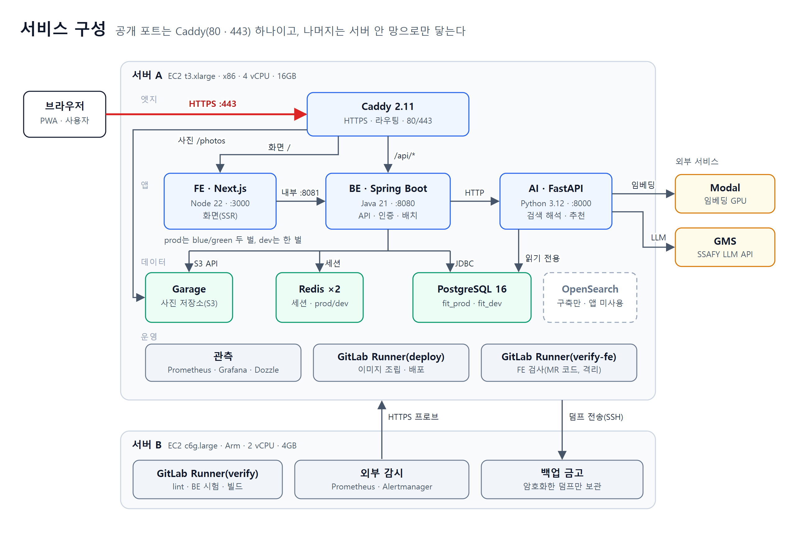
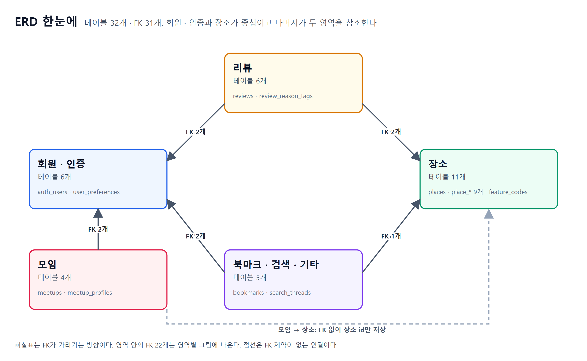

# Fit Dining

<div align="center">


---

> **SSAFY 자율 프로젝트** <br/>
> 팀 **움칫땃쥐** ( A302 ) · 2026.10.06 ~ ing

**자연어 검색 기반 장소 추천 서비스**

사용자가 마음에 들만한 장소를 쉽게 찾을 수 있도록 돕습니다.

</div>

**목차** · [주요 기능](#features) · [주요 문제 해결](#technical-cases) · [기술 스택과 구성](#system) · [실행 방법](#local-run) · [팀과 협업](#team)

<a name="features"></a>

## 📍 핏다이닝의 주요 기능


| 기능           | 사용 방법                                                                  |
| ------------ | ---------------------------------------------------------------------- |
| 자연어 장소 검색    | “강남역 근처 조용한 파스타집”처럼 원하는 조건을 문장으로 입력합니다. 결과를 본 뒤 조건을 덧붙여 다시 검색할 수 있습니다. |
| 점수와 근거로 맛집 확인 | 장소 상세에서 핏 점수와 추천 이유를 확인하고 메뉴를 살펴봅니다. |
| 취향 프로필       | 좋아하고 피하는 조건을 칩으로 고르거나 직접 입력합니다.                                        |
| 모임 장소 추천     | 모임을 만들고 참여자의 취향을 모아 함께 갈 장소를 고릅니다.                                     |


<table>
  <tr>
    <th scope="col">문장으로 검색하고 조건 추가하기</th>
    <th scope="col">점수와 근거로 맛집 확인</th>
    <th scope="col">친구들 취향으로 모임 장소 추천받기</th>
  </tr>
  <tr>
    <td></td>
    <td></td>
    <td></td>
  </tr>
</table>

Fit Dining 화면에 예시 장소와 모임 데이터를 넣어 브라우저에서 녹화했습니다.

<a name="technical-cases"></a>

## 🧪 주요 문제 해결

### 1. GEPA로 취향 입력 해석 프롬프트 개선

“신 음식은 싫어요”처럼 짧은 입력도 취향 칩으로 바꾸려면 무엇을 좋아하거나 피하는지 함께 맞혀야 합니다. 부정 표현의 방향, 업종과 메뉴의 경계, 취향이 없는 입력을 구분하도록 합성 평가셋과 채점 기준을 만들었습니다.

MLflow의 GEPA로 프롬프트 후보를 만들었습니다. 예측과 정답의 `(kind, code, like)` 집합을 자카드 점수로 비교하고, 검증셋을 따로 사용했습니다. 모델을 고정한 채 합성 문장 108개에서 각 프롬프트를 3회씩 측정했습니다.


| 프롬프트       | 회차별 평균 자카드 점수 범위 |
| ---------- | ----------------: |
| 최적화 전      | 0.665\~0.684     |
| GEPA 최적화 후 | **0.846\~0.855** |


같은 108개로 후보를 비교해 채택한 프롬프트를 제품에 적용했습니다. 코드표를 빼고 프롬프트 길이는 1,276자에서 7,702자로 늘었습니다. [평가 및 적용 커밋](https://github.com/eomgerm/fit-dining/commit/e33712f) · [취향 프로필 명세](docs/specs/taste-profile/spec.md)

### 2. 장소 페르소나 평가에서 LLM 채점과 사람의 선택 비교

장소 페르소나는 리뷰를 바탕으로 그 가게를 좋아할 손님과 그 이유를 설명합니다. GEPA로 LLM 채점 점수를 올렸지만, 채점 점수와 사람이 고른 문구 사이에 차이가 있었습니다.


| 평가                    | 기존 프롬프트   | LLM 채점 기준 최적화 후 |
| --------------------- | ---------: | ---------------: |
| LLM 채점 점수             | 0.47      | 0.72            |
| 사람 블라인드 비교에서 선택된 장소 수 | **20/25** | 5/25            |
| 임베딩 검색 점수             | **0.811** | 0.723           |


이 비교를 바탕으로 실험의 최적화 목표를 코드 규칙과 임베딩 검색 점수로 바꿨습니다. 검색 점수는 한 장소의 긍정 리뷰 구절이 같은 업종의 다른 장소 구절보다 해당 장소의 페르소나에 더 가깝게 검색되는지를 봅니다. [평가 기준 변경 커밋](https://github.com/eomgerm/fit-dining/commit/28846ef) · [페르소나 실험 코드](ai/experiments/prompt_opt/persona.py)

### 3. `gpt-6-luna` 모델 변경을 통한 추론 시간 개선

GEPA 적용 이후에는 취향 입력 프롬프트와 출력 스키마를 고정하고 모델과 추론 강도를 비교했습니다. 합성 문장 108개를 설정별로 3회씩 실행했습니다.


| 직접 입력 해석                 | 회차별 완전 일치         | 응답 p95    | 3초 초과       |
| ------------------------ | -----------------: | ---------: | -----------: |
| `gpt-4o-mini`            | 87\~90 / 108      | 2.34초     | 5 / 324     |
| `gpt-6-luna` · 추론 `none` | **98\~100 / 108** | **1.87초** | **1 / 324** |


`gpt-6-luna`의 `medium` 설정은 평균 점수가 더 높았지만 응답 324건 중 68건이 3초를 넘겼습니다. 입력 직후 칩을 보여 주는 화면이라 `none`을 채택했습니다.

리뷰 추출과 장소 페르소나 생성에도 같은 모델 설정을 적용했습니다. 리뷰 50건을 묶음 5개로 비교했을 때 추출 시간 중앙값은 12.6초에서 8.1초로 줄었습니다. 페르소나에서는 새 모델이 리뷰 번호나 집계 과정을 추천 문구에 쓰는 문제가 있었습니다. 평가셋에 없는 예시로 프롬프트를 보완한 뒤 20곳을 비교하니 그런 표현이 포함된 결과가 72/93건에서 0/84건으로 줄었습니다. [모델 비교 기록](ai/experiments/prompt_opt/README.md) · [측정 및 결정 커밋](https://github.com/eomgerm/fit-dining/commit/9b7d625)

<a name="system"></a>

## 🥢 기술 스택


| 영역     | 기술                                                                                                                                                                                                                                                                                                           |
| ------ | ------------------------------------------------------------------------------------------------------------------------------------------------------------------------------------------------------------------------------------------------------------------------------------------------------------ |
| 웹      |    · Tailwind CSS · TanStack Query · 네이버 지도 |
| API    |   · Spring Security · Flyway                                                                                              |
| AI     | Python 3.12 · FastAPI · GMS · Modal · MLflow GEPA                                                                                                                                                                                                                                                            |
| 데이터·배포 |    · pgvector · Garage · GitLab CI               |


## 🗺 시스템 아키텍처



Next.js 웹은 Spring Boot API로 검색과 장소 상세를 요청합니다. Spring Boot는 세션과 서비스 데이터를 관리하고, FastAPI 서비스에 취향 계산과 장소 추천을 맡깁니다. AI 서비스는 장소 특징과 임베딩을 사용해 후보를 비교하고 카드에 표시할 추천 근거를 돌려줍니다. [장소 검색 설계](docs/specs/place-ai-search/spec.md)

```text
.
├── fe/       # 지도, 검색, 장소 상세와 온보딩을 보여 주는 Next.js 웹
├── be/       # 인증, 장소, 리뷰, 모임 API와 DB 마이그레이션
├── ai/       # 취향 분석, 추천 검색, 리뷰 추출과 프롬프트 평가
├── infra/    # 로컬 개발 스택, 배포와 모니터링
├── docs/     # 기능 명세와 설계 결정
└── exec/     # 시스템 구성도와 ERD
```

### ERD




| 영역     | 대표 테이블                           | 저장하는 내용       |
| ------ | -------------------------------- | ------------- |
| 회원     | `auth_users`, `user_preferences` | 계정과 취향 설정     |
| 장소     | `places`, `feature_codes`        | 장소 정보와 특징 코드  |
| 리뷰     | `reviews`, `review_reason_tags`  | 방문 평가와 이유 태그  |
| 검색·북마크 | `search_threads`, `bookmarks`    | 검색 대화와 저장한 장소 |
| 모임     | `meetups`, `meetup_profiles`     | 모임 조건과 참여자 취향 |


<a name="local-run"></a>

## 🍽 로컬 실행 방법

```bash
# 1. 저장소 루트에서 개발용 데이터 서비스를 시작합니다.
test -e infra/local/.env || cp infra/local/local.env.example infra/local/.env
bash infra/local/fit-local.sh up

# 2. 별도 터미널에서 백엔드를 실행합니다.
cd be
test -e .env || cp .env.example .env
AUTH_COOKIE_SECURE=false PLACE_MOCK_ENABLED=true ./gradlew bootRun

# 3. 저장소 루트에서 새 터미널을 열고 웹을 실행합니다.
cd fe
pnpm install
pnpm dev
```

<a name="team"></a>

## 👥 팀 움칫땃쥐


| [RaonJena99](https://github.com/RaonJena99)                                                     | [eomgerm](https://github.com/eomgerm)                                                       | [kanggihoo](https://github.com/kanggihoo)                                                      | [minjae5024](https://github.com/minjae5024)                                                     | [balbi-hw](https://github.com/balbi-hw)                                                       | [dutjddnr0916-art](https://github.com/dutjddnr0916-art)                                               | [WinterI5Coming](https://github.com/WinterI5Coming)                                                 |
| :-----------------------------------------------------------------------------------------------: | :-------------------------------------------------------------------------------------------: | :----------------------------------------------------------------------------------------------: | :-----------------------------------------------------------------------------------------------: | :---------------------------------------------------------------------------------------------: | :-----------------------------------------------------------------------------------------------------: | :---------------------------------------------------------------------------------------------------: |
|  |  |  |  |  |  |  |


### 협업 규칙

- 브랜치는 `<Jira 키>/<타입>/<작업명>`을 사용합니다.
- 커밋 메시지는 `[<Jira 키>] <타입>: <설명>` 형식으로 작성합니다. Lefthook이 브랜치 이름과 커밋 메시지를 검사합니다. [협업 규칙](CONTRIBUTING.md)
- GitLab CI에서 검증, 이미지 빌드, 배포, 배포 후 점검을 실행합니다. [파이프라인 구성](.gitlab-ci.yml)
