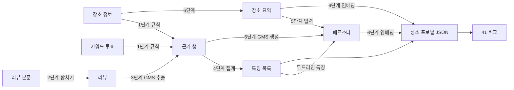

# 장소 특징 분석 베이스라인 (place-profile)

Status: draft · Jira: S15P31A302-40 · 관련: S15P31A302-39(사용자 취향 분석), S15P31A302-41(취향-장소 비교)

PRD·기술 설계와 다르면 PRD를 따른다. 대부분의 기준은 출시 지역 수집 데이터로 확인했다. 여기서 "임시"라고 적은 값은 샘플 결과를 본 뒤 다시 정한다.

## 한눈에 보기

| 항목 | 내용 |
|---|---|
| 하는 일 | 장소 정보와 리뷰에서 장소 특징을 뽑아, 사용자 취향과 같은 코드로 비교할 수 있는 장소 프로필(JSON)을 만든다 |
| 넘기는 일 | 사용자와 맞대어 점수와 주의점을 정하는 일은 41, 특징 코드표 관리는 39가 맡는다 |
| 저장 | 이번에는 JSON 파일까지만 만든다. DB 저장 형식은 [profile-storage](../profile-storage/spec.md)가 정했다. 40은 릴리즈 전 첫 생성(네이버 리뷰)만 다루고, 이후 갱신은 04:00 배치가 앱 리뷰로만 한다 |
| 완료 기준 | 출력 형식 확정, 샘플 장소 15~20곳의 프로필 생성 확인 |



| 단계 | 하는 일 | LLM |
|---|---|---|
| 0 | 입력과 어휘 정하기 | 안 씀 |
| 1 | 장소 정보와 키워드에서 규칙으로 뽑기 | 안 씀 |
| 2 | 똑같은 리뷰 합치기 | 안 씀 |
| 3 | 리뷰 본문에서 특징 뽑기 | GMS |
| 4 | 코드별로 세서 태그 라벨 정하기 | 안 씀 |
| 5 | 페르소나 만들기 | GMS |
| 6 | 장소 요약과 페르소나를 벡터로 바꾸기 | 안 씀 |
| 7 | JSON으로 출력하기 | 안 씀 |

규칙으로 확실하게 뽑을 수 있는 것은 먼저 규칙으로 뽑고, LLM은 리뷰 본문을 읽어야 알 수 있는 것에만 쓴다. 39에서 "아늑", "조용", "데이트"는 문구로 리뷰를 검색해도 무작위와 거의 차이가 없었다(39 spec 5단계). 이런 특징은 벡터보다 코드로 맞추는 편이 믿을 만하다.

## 0단계. 입력과 어휘

### 쓰는 자료

| 자료 | 어디에 쓰나 |
|---|---|
| 네이버 업종 코드(`categoryCodeList`) | 음식 종류(1단계) |
| 네이버 세부 업종 이름 | 장소 요약(6단계) |
| 메뉴 이름과 설명(`menu.items`) | 매운맛 근거(1단계), 장소 요약(6단계) |
| 시설 | 장소 요약(6단계) |
| 가까운 역 | 장소 요약(6단계) |
| 방문자 리뷰 본문 | 본문 추출(3단계) |
| 방문자 리뷰 키워드 투표 | 키워드 근거(1단계) |
| 앱 리뷰 본문과 이유 태그 | 1차 데이터가 없다. 샘플에만 손으로 만들어 넣는다 |

40은 이 자료를 읽기만 한다. 베이스라인은 출시 지역 수집 데이터를 읽고, 운영에서는 같은 필드를 DB에서 읽는다.

출시 지역 수집 데이터는 강남·역삼·선릉 일대 300곳(식당 129, 카페 87, 술집 84)이다. 장소마다 최신 방문자 리뷰 100건이 있다. 네이버는 최신순으로만 100건까지 준다. 메뉴는 287곳에 있고 13곳은 없다. 이 문서의 "출시 데이터" 수치는 모두 이 데이터로 잰 값이다.

### 쓰지 않는 자료

| 자료 | 이유 |
|---|---|
| 블로그 리뷰 | "블로그 리뷰는 저장만 하고 1차 추천에 사용하지 않는다" (기술 설계 §2.1) |
| 사진 | "사진에서 장소 특징을 뽑지 않는다" (PRD FR-10) |
| 가격 | "가격은 요약과 임베딩에 넣지 않는다" (기술 설계 §3.1) |
| 리뷰 주제별 개수(`reviewThemes`) | 좋다는 말인지 나쁘다는 말인지 알 수 없다. "극성이 없으므로 1차에서 사용하지 않는다" (기술 설계 §3.2) |
| 별점 | 특징별로 나뉘지 않는다. 한 장소의 평가를 모든 특징으로 넓히지 않는다는 원칙과도 맞지 않는다 (PRD FR-14) |

### 특징 코드

39 코드표(`features.py`)를 그대로 쓴다. 장소 쪽 코드를 따로 만들지 않는다. 사용자 코드는 같은 코드의 장소 근거와 맞대야 점수가 된다(39 spec 확장 코드). 코드표에 없는 내용(메뉴 평가, 맛 성향 등)은 버리지 않고 문장으로 남긴다.

시설(PRD L4)은 코드가 아니다. 요청 조건을 거르는 데만 쓰고, 장소 정보에 이미 있으므로 40이 다시 내보내지 않는다.

### 좋았어요와 아쉬웠어요

근거 하나는 `direction`으로 좋았는지(`1`) 아쉬웠는지(`-1`)를 적는다. 39 근거 장부의 `direction`과 같은 이름이고, 뜻은 리뷰 이유 태그의 좋았어요·아쉬웠어요와 같다(PRD FR-10 표).

| 리뷰 내용 | 코드 | `direction` |
|---|---|---|
| 조용해서 좋았어요 | `QUIET` | 1 |
| 너무 썰렁했어요 | `QUIET` | -1 |
| 활기차서 좋았어요 | `LIVELY` | 1 |
| 너무 시끄러워서 대화가 힘들었어요 | `LIVELY` | -1 |
| 자리가 넉넉했어요 | `SPACIOUS_SEATING` | 1 |
| 자리가 좁았어요 | `SPACIOUS_SEATING` | -1 |

- 소음 축은 손님이 **실제로 느낀 쪽**을 코드로, **그게 좋았는지**를 `direction`으로 적는다. 그래야 조용한 곳을 좋아하는 사용자에게 "시끄럽다는 불만"을 주의점으로 보여 줄 수 있다.
- 중요 기준과 방문 목적은 `1`이면 그 기준을 채웠다는 뜻이고 `-1`이면 못 채웠다는 뜻이다.
- 앱 리뷰 이유 태그는 39 근거 장부와 같은 태그를 쓰지만 적는 방향이 다르다. 39는 "이 사용자가 무엇을 원하나"를 적고, 40은 "이 장소가 어땠나"를 적는다.

  | 이유 태그 | 39 근거 장부(사용자) | 40 근거 행(장소) |
  |---|---|---|
  | 너무 시끄러웠어요 | `QUIET` +1 (조용함을 원함) | `LIVELY` -1 (시끄러웠고 아쉬웠음) |
  | 너무 썰렁했어요 | `LIVELY` +1 | `QUIET` -1 |
  | 자리가 좁았어요 | `SPACIOUS_SEATING` +1 (자리를 중요하게 여김) | `SPACIOUS_SEATING` -1 (자리가 좁았음) |
  | 조용해서 좋았어요 | `QUIET` +1 | `QUIET` 1 |

- 기술 설계 §3.2의 "혼합"은 두지 않는다. 섞인 근거는 좋았어요에도 아쉬웠어요에도 세지 않으므로 남겨도 쓸 곳이 없다. "평일엔 조용한데 주말엔 시끄러워요"처럼 조건이 다른 관찰은 섞인 것이 아니라 `QUIET` 1과 `LIVELY` -1 두 개로 본다.

## 1단계. 규칙으로 뽑기

### 음식 종류

네이버 업종 코드 목록(`categoryCodeList`)의 두 번째 코드로 39의 음식 종류 코드 5개 중 하나를 정한다. 이 일은 40이 맡는다(39 spec 확장 코드).

| 두 번째 코드 | `food_type` | 출시 데이터의 세부 업종 |
|---|---|---|
| 220037 | `FOOD_KOREAN` | 한식, 육류·고기요리, 돼지고기구이, 소고기구이, 곱창·막창·양, 생선회, 한정식, 국밥, 곰탕·설렁탕, 냉면, 복어요리 등 20종 |
| 220048 | `FOOD_KOREAN` | 종합분식 |
| 220038 | `FOOD_JAPANESE` | 일식당, 샤브샤브, 일본식라면, 초밥·롤 |
| 220039 | `FOOD_CHINESE` | 중식당, 양꼬치 |
| 220044 | `FOOD_WESTERN` | 양식, 이탈리아음식, 스페인음식, 피자, 햄버거 |
| 220041, 220042 | `FOOD_ASIAN` | 베트남음식, 인도음식 |
| 220046 | `null` | 뷔페 |

- 업종 그룹(식당·카페·술집)을 나누는 것과 같은 필드다(기술 설계 §2.3). 카페(220052)와 술집(220051)은 이미 업종 그룹이라 `null`이다(39 spec).
- 세부 업종 이름으로 표를 만들면 이름이 늘 때마다 표를 고쳐야 한다. PoC 업종 이름으로 만든 표는 출시 데이터 식당 129곳 중 88곳만 덮었다. 코드로 나누면 129곳이 모두 들어간다.
- 샤브샤브를 일식으로, 양꼬치를 중식으로 보는 것도 네이버 분류를 그대로 따른다. "네이버 분류를 그대로 따르며 예외를 두지 않는다"(PRD FR-01).
- 분식은 한식으로 둔다. 39가 "고기구이나 분식은 한식의 하위 분류"라고 정했다.
- 처음 보는 코드는 `null`로 두고 `report.json`에 모아 사람이 확인한다. 기술 설계 §2.3이 처음 보는 업종 코드를 다루는 방식과 같다.
- 음식 종류는 `features`가 아니라 `food_type`에 따로 둔다. 업종은 리뷰 근거가 아니라 사실이라 "근거 3개 이상" 규칙이 맞지 않는다.

### 키워드 투표

방문자 리뷰의 키워드 투표를 코드로 바꾼다. 키워드는 손님이 네이버가 정해 둔 문구를 직접 고른 것이라, LLM이 본문을 읽고 짐작한 것보다 믿을 만하다. 출시 데이터 리뷰 30,000건 중 29,394건(98%)에 키워드가 있었다. 키워드 근거는 출처를 따로 표시한다. "키워드 투표에서 온 근거는 출처를 '키워드'로 표시한다"(기술 설계 §3.2).

"근거 3건 이상 장소"는 키워드만으로 셌을 때 그 코드의 근거 리뷰가 3건 이상인 장소 수다.

| 코드 | 키워드 | 출시 데이터 투표 수 | 근거 3건 이상 장소 |
|---|---|---|---|
| `QUIET` | 차분한 분위기예요 | 745 | 83 (28%) |
| `SPACIOUS_SEATING` | 매장이 넓어요, 좌석이 편해요 | 4,882, 336 | 252 (84%) |
| `GENEROUS_PORTION` | 양이 많아요 | 3,476 | 144 (48%) |
| `PRETTY_SPACE` | 인테리어가 멋져요 | 8,209 | 286 (95%) |
| `VIEW_OUTDOOR` | 뷰가 좋아요, 야외공간이 멋져요 | 686, 189 | 77 (26%) |
| `COZY` | 아늑해요 | 695 | 95 (32%) |
| `VALUE_FOR_MONEY` | 가성비가 좋아요, 비싼 만큼 가치있어요 | 3,834, 686 | 271 (90%) |
| `UNIQUE_CONCEPT` | 컨셉이 독특해요 | 285 | 36 (12%) |
| `FAST_SERVING` | 음식이 빨리 나와요 | 423 | 42 (14%) |
| `GOOD_MUSIC` | 음악이 좋아요 | 1,487 | 88 (29%) |
| `PURPOSE_TALK` | 대화하기 좋아요 | 3,888 | 193 (64%) |
| `PURPOSE_SOLO` | 혼밥하기 좋아요, 혼술하기 좋아요 | 898, 210 | 85 (28%) |
| `PURPOSE_DATE` | 특별한 날 가기 좋아요 | 353 | 32 (11%) |
| `PURPOSE_GROUP` | 단체모임 하기 좋아요 | 3,078 | 196 (65%) |
| `PURPOSE_WORK` | 집중하기 좋아요 | 567 | 62 (21%) |

- 키워드는 좋은 말만 있으므로 `direction`은 늘 `1`이다.
- `LIVELY`와 `SHORT_WAIT`는 맞는 키워드가 없다(39 spec). 이 두 코드와 모든 아쉬웠어요 근거는 3단계 리뷰 본문에서만 나온다.
- 한 리뷰가 같은 코드의 키워드 두 개("매장이 넓어요", "좌석이 편해요")에 투표해도 근거는 하나다.
- `FAST_SERVING`과 `GOOD_MUSIC`은 출시 데이터를 보고 39가 코드표에 더한 코드다. `GOOD_MUSIC`은 근거 3건 이상 장소 88곳 중 74곳이 술집이다.
- 쓰지 않는 키워드:
  - 맛·친절·청결("음식이 맛있어요", "친절해요", "매장이 청결해요" 등): 거의 모든 사용자가 원하는 품질이라 취향으로 받지 않는다(PRD FR-06)
  - 아이·반려동물·룸·주차: 39가 뺀 항목이거나 시설이다
  - "사진이 잘 나와요": 음식 사진인지 공간 사진인지 분명하지 않다. `PRETTY_SPACE`에 합치면 이미 95%인 근거가 더 흔해져 장소를 구분하지 못한다
  - "오래 머무르기 좋아요", "파티하기 좋아요": 어느 코드인지 분명하지 않다
  - "건강한 맛이에요": 39가 직접 입력 해석 샘플로 확인할 때까지 보류한다
  - "라이브공연이 훌륭해요", "읽을만한 책이 많아요", "샐러드바가 잘 되어있어요" 등 출시 데이터에서 새로 본 키워드: 맞는 코드가 없다

### 매운맛

`FOOD_SPICY`의 주 근거는 3단계 리뷰 본문의 '맛 성향' 칸이다. 메뉴는 보조 근거로 장소당 최대 1개만 센다.

- 메뉴 이름이나 설명에 "매운", "매콤", "얼큰", "불닭", "땡초", "마라탕", "마라샹궈", "마라룽샤"가 들어 있는 메뉴가 하나라도 있으면 근거 1개다(임시). '마라'만 쓰면 '고구마라떼'에도 걸리므로 붙여 쓴다(39 확인).
- 메뉴 하나를 근거 하나로 세지 않는다. 같은 메뉴가 시간대별로 여러 줄 올라온 경우가 있다("마라홍탕 (평일 11시~15시까지)", "마라홍탕 (평일 15시~/공휴일)").
- 메뉴만으로는 PRD 기준을 넘지 못한다. 출시 데이터에서 매운 메뉴가 3개 이상인 장소는 20곳(7%)뿐이었다. 리뷰 본문에서 매운맛을 3건 이상 언급한 장소는 23%였다(39 측정). 39 확장 코드 표가 정한 장소 쪽 근거("리뷰 언급, 메뉴명")와 같은 자료를 쓰되, 비중을 본문 쪽에 둔다.

## 2단계. 똑같은 리뷰 합치기

한 사람이 복사해 붙인 리뷰가 근거 여러 개로 부풀지 않게, 같은 장소 안에서 똑같은 리뷰를 하나로 합친다(기술 설계 §3.3).

- 10자 이상인 리뷰를 글자 5개씩 잘라 비교한다. 조각이 80% 이상 겹치면 같은 리뷰로 본다(Jaccard 0.8).
- 수집 목록에서 먼저 나온 리뷰 하나만 남긴다. 방문일(`visited`)과 작성일(`created`)은 "10.20.화"처럼 연도 없이 들어 있어 날짜로 고를 수 없다. 합치는 리뷰는 내용이 같으므로 어느 쪽을 남겨도 결과가 같다.
- 출시 데이터에서는 33곳에서 69건이 합쳐졌다. 한 장소에서 가장 많이 합쳐진 것은 16건이다. 합쳐진 예시는 모두 진짜 복사본이었다.
- 벡터로 비교하지 않는다. PoC에서 서로 다른 짧은 칭찬 리뷰가 0.97~0.98로 나와 기준값을 정할 수 없었다(기술 설계 §3.3).
- 같은 틀로 문장만 바꾼 리뷰는 합치지 못한다. 이 한계는 기술 설계 §3.3에 이미 적혀 있고, 샘플에서 사례 수만 센다(PRD OQ-12).

## 3단계. 리뷰 본문에서 특징 뽑기

### GMS 호출

39와 같은 `gms.py`를 쓴다.

| 항목 | 값 |
|---|---|
| 모델 | `gpt-6-luna`, 추론 강도 `none`, JSON 스키마(strict) 출력. 이 모델은 temperature 0을 받지 않아 temperature는 보내지 않는다. 2026-11-06에 `gpt-4o-mini`(temperature 0)에서 바꿨다. 실제 리뷰 50개에서 검사에 버려지는 항목이 36개에서 1개로 줄고 묶음 시간도 짧아졌다(`ai/experiments/prompt_opt/README.md`) |
| 묶음 | 리뷰 10개를 한 번에 보낸다. 리뷰 ID 대신 1부터 번호를 붙여 JSON 배열로 보내고, 결과는 리뷰별로 나눠 받는다(기술 설계 §3.2) |
| 시간 제한 | 60초. 리뷰 10개를 한 번에 보내서 39의 기본값(10초)보다 길게 둔다 |
| 실패 | 호출 실패나 검사 실패면 한 번 다시 요청한다. 그래도 실패하면 그 묶음의 리뷰를 버린다(기술 설계 §3.6) |
| 로그 | 리뷰 원문과 응답 본문은 남기지 않는다. 실패 종류만 남긴다 |

GMS 답은 실행마다 조금씩 다르다(temperature 0이어도 그랬다). 그래도 같은 모양의 실수는 다시 요청해도 되풀이되는 일이 많아서, 실수가 생길 수 없게 응답 스키마로 막는다(아래 응답 형식).

### 정리 칸

기술 설계 §3.2의 8칸을 그대로 쓴다.

| 칸(`slot`) | 내용 | 붙을 수 있는 코드 |
|---|---|---|
| 메뉴 평가 | 언급한 메뉴와 평가 | 없음. 문장으로 남긴다 |
| 맛 성향 | 매움, 담백, 간 | `FOOD_SPICY` |
| 소음·분위기 | 조용·시끄러움, 아늑·어수선, 음악 | `QUIET`, `LIVELY`, `COZY`, `UNIQUE_CONCEPT`, `GOOD_MUSIC` |
| 공간 | 좌석, 넓이, 인테리어, 전망·야외 | `SPACIOUS_SEATING`, `PRETTY_SPACE`, `VIEW_OUTDOOR` |
| 대기·서비스 | 대기, 음식이 나오는 속도, 응대 | `SHORT_WAIT`, `FAST_SERVING` |
| 양·가격 만족 | 양, 가격 대비 만족 | `GENEROUS_PORTION`, `VALUE_FOR_MONEY` |
| 방문 목적 | 대화, 혼밥, 데이트, 모임, 작업 | `PURPOSE_*` |
| 방문 맥락 | 누구와, 언제 | 없음. 리뷰에 적힌 사실만 남긴다 |

### 프롬프트에 넣는 것

- 8칸 이름과 칸별로 쓸 수 있는 코드
- 리뷰에 없는 내용은 쓰지 않는다. EXP3RT가 지시문에 넣은 "리뷰에 없는 내용은 쓰지 말 것"과 같다
- 항목 하나에는 코드를 하나만 붙인다
- 붐빈다는 말만으로 시끄럽다고 하지 않는다(기술 설계 §3.5)
- 시간대나 요일이 붙은 관찰은 그 조건을 문장에 남긴다. 특정 시간의 관찰을 모든 시간에 맞는 것처럼 쓰지 않는다(기술 설계 §3.5)
- 맛·친절·청결 같은 일반 품질에는 코드를 붙이지 않는다

### 응답 형식

리뷰 번호를 키로, 그 리뷰의 항목 목록을 값으로 받는다. 보낸 리뷰 수만큼 키("1"~"10")를 모두 필수로 둔다.

```json
{
  "1": [
    {"slot": "소음·분위기", "quote": "너무 시끄러워서 대화가 힘들었어요", "code": "LIVELY", "direction": -1, "text": null},
    {"slot": "메뉴 평가", "quote": "된장찌개가 진하고 맛있어요", "code": null, "direction": 1, "text": "된장찌개가 진하다"}
  ],
  "2": []
}
```

| 필드 | 뜻 |
|---|---|
| `slot` | 8칸 중 하나 |
| `quote` | 리뷰에서 그대로 따온 구절 |
| `code` | 코드표의 코드 또는 `null` |
| `direction` | `1` 또는 `-1` |
| `text` | 코드가 없을 때 짧게 정리한 문장. 코드가 있으면 `null` |

처음에는 `{"reviews": [{"no": 1, "items": [...]}, ...]}`처럼 배열로 받았다. 샘플 20곳을 돌리니 리뷰 묶음 7개가 두 번 다 실패했다. 모델이 첫 리뷰 하나만 답하고 멈추거나(받은 번호 `[1]`, `[1, 2]`) 없는 11번을 더했고, 다시 요청해도 같은 답이 왔다. 번호를 키로 고정한 뒤 같은 묶음 7개를 다시 부르니 모두 통과했다.

### 검사

서비스 코드가 LLM 응답을 검사한다. LLM이 준 확신 점수 같은 값은 받지도 쓰지도 않는다(기술 설계 §3.5).

| 검사 | 실패하면 |
|---|---|
| JSON 형식, 보낸 리뷰 번호가 빠짐없이 한 번씩 있는지 | 다시 요청 |
| `slot`이 8칸 중 하나인지, `direction`이 1이나 -1인지 | 다시 요청 |
| `quote`가 비어 있지 않고 리뷰 원문에 그대로 있는지 | 그 항목만 버린다 |
| `code`가 `null`이거나, 그 칸에 붙을 수 있는 코드인지(빈 문자열은 버린다) | 그 항목만 버린다 |

`quote`를 원문과 대조해 LLM이 리뷰에 없던 특징을 지어내지 못하게 한다. 39의 직접 입력 해석도 같은 방식으로 검사한다.

대조는 양쪽 공백을 줄인 뒤에 한다. 모델이 리뷰의 줄바꿈을 띄어쓰기로 옮겨 적어서, 그대로 대조하면 맞는 구절도 버려졌다. 한 장소는 남은 항목 6개에 버려진 항목이 16개였고, 대부분 이 경우였다.

### 한 리뷰 안에서 정리하기

- 같은 리뷰에서 같은 코드가 같은 방향으로 여러 번 나오면 근거는 하나다. 키워드와 본문이 같은 코드를 가리킬 때도 그렇다.
- 같은 리뷰에서 같은 코드가 좋았어요와 아쉬웠어요로 엇갈리면 그 코드는 그 리뷰에서 세지 않는다.
- 근거 있는 항목이 하나도 없는 리뷰는 버린다(기술 설계 §3.2).

### 이 단계를 믿을 수 있는 정도

프롬프트만으로 리뷰 특징을 뽑으면 식당 데이터에서 F1이 51.5였다. 학습시킨 모델은 60.4였다(Hellwig 외 2025, 영어 데이터). 절반 가까이 틀릴 수 있으므로 항목 하나하나를 믿지 않는다. `quote` 대조로 지어낸 항목을 거르고, 4단계에서 근거가 3개 이상 모여야 특징으로 인정한다.

## 4단계. 코드별로 세기

근거 행을 코드마다 세서 특징 목록을 만든다. LLM은 쓰지 않는다.

1. **리뷰 단위로 센다.** 코드마다 `direction`이 1인 리뷰 수를 `like_count`, -1인 리뷰 수를 `dislike_count`로 둔다. 메뉴 근거는 장소당 최대 1개다(1단계).
2. **비율을 구한다.** 코드마다 `like_count` ÷ 그 장소의 분석한 리뷰 수(2단계에서 합친 뒤)를 구한다.
3. **업종 그룹 평균을 구한다.** 같은 업종 그룹(식당·카페·술집) 장소들의 비율 평균이다. 근거가 없는 장소는 0으로 넣는다.
4. **태그 라벨을 정한다.** 다음 세 가지를 모두 채우면 `is_label: true`다. 2단계의 분석한 리뷰 수는 출력의 `analyzed_review_count`로 남긴다. 네이버 리뷰를 저장하지 않아 적재 뒤 앱 리뷰로 비율을 다시 구할 때 이 값이 분모다(profile-storage D-8).
   - `like_count`가 3 이상
   - `like_count`가 `dislike_count`보다 많음
   - 비율이 그 장소가 속한 업종 그룹 평균보다 높음
5. **근거가 없는 코드는 넣지 않는다.** 목록에 없는 코드는 "모름"이다. 0을 적으면 "그 특징이 없다"로 읽힐 수 있다. "근거가 없는 특징은 '모름'으로 처리한다"(기술 설계 §3.4).

### 업종 그룹 평균을 쓰는 이유

기술 설계 §3.2는 "근거 3개 이상이고 긍정이 다수인 태그를 장소의 태그 라벨로 둔다"고 정했다. 그런데 장소마다 리뷰가 100건이라 3건은 3%에 불과하다. 출시 데이터에 이 기준만 쓰면 거의 모든 장소에 같은 라벨이 붙는다. 아래는 키워드 근거만으로 센 값이다.

| | 3건 이상 + 과반 | 업종 그룹 평균 초과 추가 |
|---|---|---|
| `PRETTY_SPACE` 라벨 | 286곳 | 140곳 |
| `VALUE_FOR_MONEY` 라벨 | 271곳 | 106곳 |
| `SPACIOUS_SEATING` 라벨 | 252곳 | 135곳 |
| 카드 특징 2개 조합 종류 | 31가지 | 100가지 |
| 가장 흔한 조합 | 공간이 예쁨 + 대화 (82곳) | 빨리 나옴 + 양 충분 (12곳) |

카드 특징이 대부분 "공간이 예쁜 곳 · 가성비"면 장소를 고르는 데 도움이 되지 않는다(PRD FR-08). 업종 그룹 안에서 비교하면 한 업종에 몰린 코드도 자연스럽게 처리된다. 예를 들어 `GOOD_MUSIC`의 평균은 술집 16.3%, 카페 0.8%이고, `PURPOSE_WORK`는 카페 6.2%, 식당 0.1%다.

"근거 3개"는 PRD §8의 초기 기준이다. 3건 기준은 그대로 두고 업종 그룹 평균 조건만 더했다.

이 기준은 PRD OQ-03의 태그 거르기와 다르다. 태그 거르기는 "장소별 최신 방문자 리뷰 100건 중 근거가 3건 이상인 장소가 전체의 10% 이상"인 태그만 남기는 규칙이고 39 spec이 다룬다. 출시 데이터에서는 키워드만으로도 모든 코드가 통과한다. 가장 낮은 것은 `PURPOSE_DATE` 11%다.

### 계산 예

| 상황 | 결과 |
|---|---|
| 카페, "대화하기 좋아요" 키워드 30건(30%), 카페 평균 15.8% | `PURPOSE_TALK` 30 / 0, 라벨 |
| 카페, "대화하기 좋아요" 키워드 10건(10%), 카페 평균 15.8% | `PURPOSE_TALK` 10 / 0, 라벨 아님(평균 이하) |
| "활기차서 좋았다" 2건, "시끄러워 힘들었다" 4건 | `LIVELY` 2 / 4, 라벨 아님 |
| "넓어요" 키워드 3건, "좁았다" 3건 | `SPACIOUS_SEATING` 3 / 3, 라벨 아님(과반이 아님) |
| 매운 메뉴만 있음 | `FOOD_SPICY` 1 / 0, 라벨 아님 |
| 소음 이야기가 하나도 없음 | `QUIET`, `LIVELY` 모두 목록에 없음 |

### 카드 특징 고르는 순서 (제안, 41이 정함)

장소 카드에는 특징 2개가 나온다. PRD FR-08은 요청이나 취향과 맞는 라벨을 먼저 보여 주고, 맞는 라벨이 없으면 "근거가 많은 라벨"을 보여 주라고 한다. 그런데 라벨이 여러 개일 때 어느 것을 먼저 보여 줄지, 라벨이 2개가 안 될 때 빈칸을 어떻게 채울지는 정해지지 않았다. 키워드만으로 셌을 때 라벨이 0개인 장소가 7곳, 1개인 장소가 11곳이었다. 본문 근거가 더해지면 늘어난다.

40은 다음 순서를 제안한다.

1. 라벨이 붙은 코드를 업종 그룹 평균보다 높은 정도(비율 ÷ 그룹 평균)가 큰 순서로 고른다. 그 장소만의 특징이 앞에 온다.
2. 라벨이 2개가 안 되면 `like_count` 3 이상이고 과반인 코드로 채운다. 순서는 1과 같다. 근거가 3건 이상 있는 사실이라 근거 없는 특징을 충족했다고 설명하지 않는다는 규칙(PRD AC-08)에 걸리지 않는다.
3. 그래도 모자라면 있는 만큼만 보여 준다. 근거가 없는 특징으로 칸을 채우지 않는다.

이 제안을 따르면 40이 `features`를 이 순서로 정렬해 내보내고, 41·BE는 맞는 라벨을 먼저 고른 뒤 남는 칸을 목록 앞에서부터 채운다. 카드에 무엇을 넣을지는 요청·취향과 맞추는 41이 비교 베이스라인을 보고 정한다. 정해지기 전까지 40은 `features`를 이 순서로 정렬해 둔다.

### 주의점과 아쉬웠어요 근거

주의점은 여기서 정하지 않는다. 주의점은 "그 사용자와 관련 있을 때만" 보여 주므로(PRD FR-08) 사용자와 요청을 아는 41이 `dislike_count` 3 이상인 코드에서 고른다. 41이 라벨 대신 비율로 점수를 낼 수도 있으므로 `like_count`와 `dislike_count`는 그대로 내보낸다.

아쉬웠어요 근거는 적게 나올 것이다. 키워드에는 좋은 말만 있다. 출시 데이터에서 `LIVELY` 쪽(시끄러움·활기 언급) 근거가 3건 이상인 장소는 20곳(7%)이었다. "안 시끄러워요" 같은 부정형을 뺀 값이다. `QUIET` 쪽은 83곳(28%)이고, 소음 근거가 아예 없는 장소가 68%다(39 측정). '웨이팅·대기' 언급이 3건 이상인 장소는 40곳이었지만 좋은 뜻과 나쁜 뜻이 섞여 있다. USC/ISI 연구에서도 부정 라벨을 맞힌 정도가 낮았다(분위기 F1 0.19, 메뉴 0). 샘플에서 코드별 `dislike_count` 분포를 `report.json`에 따로 낸다.

## 5단계. 페르소나 만들기

페르소나는 "이 장소를 좋아할(또는 아쉬워할) 손님은 이런 사람"이라는 설명이다(PRD §2). 41은 사용자 취향과 페르소나를 비교해 핏 점수를 낸다(PRD FR-08).

### 입력

페르소나는 4단계 특징 목록을 받아야 해서 모든 장소의 근거를 센 뒤에 만든다. LLM에 리뷰 원문을 넣지 않고 다음을 넣는다.

| 입력 | 내용 |
|---|---|
| 장소 요약(6단계) | 참고용. 업종과 메뉴를 알아야 어떤 손님인지 그릴 수 있다. 장소 정보만으로 만들므로 먼저 만든다 |
| 이 장소에서 두드러진 특징 | 4단계에서 라벨이 붙은 코드의 이름(같은 업종 평균보다 많이 언급됨) |
| 네이버 키워드 투표 | 키워드별 개수 한 줄. 예: "단체모임 하기 좋아요 12건, 양이 많아요 8건" |
| 리뷰별 근거 | 3단계 항목을 리뷰 단위로 묶는다. 리뷰 번호(r1, r2 …), 출처, 칸, 코드, 좋았어요·아쉬웠어요와 내용. 아쉬웠어요가 있는 리뷰를 앞에 따로 둔다 |

- 리뷰별 근거의 내용에는 **네이버 리뷰 구절(`quote`)을 넣지 않는다.** 코드가 있으면 코드 이름("활기찬 곳"), 없으면 3단계에서 정리한 문장("된장찌개가 진하다")을 넣는다. 앱 이유 태그는 우리 문구라 그대로 넣는다.
- 키워드 투표는 줄마다 넣지 않고 개수로만 센다. 키워드만 있는 리뷰는 리뷰 번호를 받지 않는다.

Persona4Rec도 리뷰 원문 대신 아이템 요약과 리뷰마다 정리한 추출 결과를 넣는다(Persona4Rec §3.1.1, 공개 저장소의 Yelp 프롬프트). 리뷰가 많을 때 LLM은 부정 의견을 긍정보다 약하게 요약했고, 관련 문장을 먼저 골라 넣으면 이 차이가 줄었다(LFOSum). 아쉬웠어요가 있는 리뷰를 따로 앞에 두는 이유다.

이렇게 정한 이유는 샘플에서 겪은 두 가지 문제다.
- **흐린 페르소나:** 처음에는 코드와 키워드 투표를 한 줄씩 넣었다. 키워드 투표가 수십 줄씩 들어가 모델이 쓸 구체적인 재료가 적었고, "가성비 중시 손님"처럼 어느 장소에나 붙는 페르소나가 장소마다 똑같이 나왔다(다른 장소와 유사도 최대 0.995).
- **리뷰 인용:** 리뷰 구절을 넣었더니 모델이 이유 문장에 "리뷰에서 '…'라는 언급이 있었고"처럼 짧게 인용했다. 페르소나 104개 중 20개가 리뷰 구절을 그대로 옮겼다. "인용하지 말라"는 지시만으로는 막히지 않아(한 실행에서 4곳의 페르소나가 거의 다 버려짐) 입력에서 구절을 뺐다.

### 출력

```json
{"personas": [
  {"name": "퇴근 후 팀 회식", "description": "퇴근 뒤 팀원들과 고기를 구우며 왁자지껄하게 먹고 싶은 손님이다. …(3문장)", "reason": "단체석이 넉넉하고 삼겹살과 목살을 여럿이 나눠 먹기 좋다는 평가가 많다. …(3문장)", "like": true, "review_ids": ["r1", "r7", "r9", "r12"]}
]}
```

| 필드 | 뜻 | 출처 |
|---|---|---|
| `name` | 2~4단어. 근거에 기대어 구체적으로 | Persona4Rec |
| `description` | 3문장. 근거에서 찾은 방문 동기와 기준으로 어떤 손님인지 | Persona4Rec |
| `reason` | 3문장. 근거의 구체적인 신호(메뉴, 방문 상황, 시간대, 공간)를 들어 왜 좋아하는지, 또는 왜 아쉬워하는지 | Persona4Rec(preference rationale) |
| `like` | 만족한 손님이면 `true`, 아쉬워한 손님이면 `false`. 39 특징의 `like`와 같은 이름이다 | 추가(기술 설계 §3.4) |
| `review_ids` | 근거가 된 리뷰 번호 | 추가(기술 설계 §3.4) |

Persona4Rec의 페르소나는 이름, 설명, 선호 이유 세 필드이고, 그 아이템을 좋아할 손님만 다룬다. 리뷰 번호도 달지 않는다. 우리는 만족·불만을 나누고 근거 리뷰 번호를 단다. 불만 페르소나는 주의점과 감점에 쓰고, 리뷰 번호는 "근거 리뷰 3개 이상인 페르소나만 점수에 쓴다"는 규칙(PRD FR-08)에 필요하다. 기술 설계 §9도 "극성 구분과 비선호 분리를 추가한 변형. 논문 재현 아님"이라고 적었다.

GMS 호출은 3단계와 같은 `gpt-6-luna`, 추론 강도 `none`이다(2026-11-06에 `gpt-4o-mini`에서 바꿨다. 합성 20곳에서 rules 0.967 → 0.980, search 0.817 → 0.884. `ai/experiments/prompt_opt/README.md`). 사람 블라인드 비교는 아직 하지 않았다.

프롬프트 규칙은 Persona4Rec 공개 저장소의 Yelp 페르소나 프롬프트 구조를 따른다. 그 코드에는 라이선스가 없어 구조만 참고하고 문장은 새로 썼다(기술 설계 §3.4).

- 장소마다 2~7개를 만든다. 리뷰 신호가 다양할수록 많이 만드는 Persona4Rec의 범위와 같다.
- 중복이나 거의 같은 페르소나는 만들지 않는다(Persona4Rec).
- 소수의 비판 의견은 긍정 다수와 섞어 중립으로 만들지 말고 따로 남긴다(Persona4Rec, 기술 설계 §3.4).
- 근거에 나온 취향 특징은 빠짐없이 다룬다. 두드러진 특징을 먼저 다루되, 가성비처럼 여러 장소에 있는 특징도 빼지 않는다. 이런 특징도 온보딩 취향이라 사용자와 맞댈 페르소나가 있어야 한다. 같은 특징이라도 이 장소의 메뉴와 상황을 들어 다른 장소와 구별되게 쓴다.
- 리뷰 구절을 따옴표로 인용하지 않는다. 근거는 메뉴 이름이나 방문 상황으로 풀어 쓴다.
- 입력 자료를 보고 판단한 과정은 쓰지 않는다. 리뷰 번호(r1 등), 리뷰·키워드 투표 건수, "리뷰에서 확인된다", "근거가 있다" 같은 말 대신 장소와 손님을 직접 설명한다. 세 필드는 추천 이유로 화면에 나간다. `gpt-6-luna`로 바꾸자 페르소나 93개 중 72개에 이런 말이 섞여(리뷰 번호만 31개) 2026-11-06에 더했다. 더한 뒤 같은 20곳에서 84개 중 0개였다.

샘플에서 "업종에서 흔한 특징만으로는 페르소나를 만들지 말라"는 지시도 시험했다. 가성비와 모임 페르소나가 줄어 그 코드의 순위 정확도가 떨어져(가성비 AP 0.64 → 0.57, 모임 0.53 → 0.38) 쓰지 않는다.
- 근거 리뷰가 3개 이상인 페르소나만 점수에 쓴다(기술 설계 §3.4). 40은 모두 출력하고, DB 적재 때 `review_ids`가 3개 이상인 것만 넣는다. 네이버 리뷰 ID는 저장하지 않으므로 DB의 `review_ids`는 앱 리뷰 ID만 담고 처음엔 비어 있다(profile-storage D-7). 따로 표시하는 필드는 두지 않는다.
- 근거가 될 리뷰가 하나도 없는 장소는 페르소나 없이 요약만 만든다(기술 설계 §3.1).

### 검사

| 검사 | 실패하면 |
|---|---|
| JSON 형식, 필드, 개수 2~7개 | 다시 요청. 그래도 실패하면 페르소나 없이 요약만 만든다 |
| `review_ids`가 비어 있지 않고 모두 그 장소의 실제 리뷰인지 | 그 페르소나만 버린다 |
| `name`, `description`, `reason`이 네이버 리뷰 원문과 연속 20자 이상 겹치지 않는지 | 그 페르소나만 버린다 |
| 따옴표 안 구절(5자 이상)이 네이버 리뷰 원문에 그대로 있지 않은지 | 그 페르소나만 버린다 |

개수 2~7개는 응답 스키마(`minItems`, `maxItems`)로도 강제한다. 근거가 228줄인 장소에서 모델이 8개를 만들었고, 다시 요청해도 같았다.

마지막 두 검사를 두는 이유는 페르소나 문장이 추천 이유로 화면에 나가기 때문이다. 외부 리뷰 원문은 어떤 화면에도 보여 주면 안 된다(PRD AC-25, 기술 설계 §3.6). 리뷰와 페르소나 양쪽 모두 공백을 줄여서 대조한다. 줄바꿈이 끼면 베낀 문장을 놓친다.

### 페르소나끼리 너무 비슷한지 재기

LLM이 만든 사용자 페르소나끼리는 유사도가 0.94~0.99였다. 실제 사람끼리는 0.56~0.68이었다(Persona Fidelity Gap). 장소 페르소나에서도 같은 일이 생기면 41에서 장소 사이 점수 차이가 나지 않는다. 개수를 억지로 늘리지 않는다. Persona4Rec에서 페르소나를 1개에서 7개로 늘렸을 때 HR@10은 0.0824에서 0.0848로 조금만 올랐다.

**재는 법.** 페르소나 벡터(6단계) 두 개의 코사인 유사도를 잰다. 1에 가까울수록 비슷하다. `report.json`에 다음 두 가지를 낸다.
- 같은 장소 안 페르소나 쌍의 유사도
- 페르소나마다 다른 장소 페르소나 중 가장 가까운 것과의 유사도

이 값만 보면 판단을 그르친다. 샘플(처음 프롬프트)에서 다른 장소 최근접 중앙값은 0.905였지만, 같은 장소 쌍(0.571)과 다른 장소 쌍 전체(0.566)는 거의 같았다. 페르소나는 장소별이 아니라 특징별로 비슷하다. 그래서 41이 실제로 쓰는 방식으로도 재 봤다. 이 값은 `report.json`에 넣지 않고 확인용 스크립트로 쟀다.
- **코드 질의 AP:** 코드 문구("조용하고 차분한 곳")를 질의로 넣어, 근거 3개 이상인 만족 페르소나와의 최대 유사도로 장소 순위를 매긴다. 라벨이 붙은 장소가 위로 오는지 AP로 잰다. 무작위면 0.35다.
- **참고로 같이 본 것:** 다른 장소 리뷰 본문 무작위 쌍의 유사도는 중앙값 0.450, 장소 요약끼리는 0.436이었다.

**샘플 결과.** 같은 본문 추출 결과로 페르소나만 바꿔 만들었다.

| | 처음 프롬프트 | 지금 프롬프트 |
|---|---|---|
| 페르소나 수(점수에 쓰는 것) | 122(93) | 102(67) |
| 다른 장소 최근접 중앙값 | 0.905 | 0.835 |
| 다른 장소와 0.95 넘게 비슷한 페르소나 | 16개 | 0개 |
| 두 장소 이상에서 똑같은 이름 | 22종 | 15종 |
| 코드 질의 AP | 0.64 | 0.74 |

- 입력에 리뷰 구절을 넣었던 중간 실험에서는 최근접 중앙값이 0.773까지 내려갔다. 구절을 빼면서 구체성이 조금 줄었지만, 화면에 리뷰를 인용하면 안 되는 규칙 때문에 받아들인다.
- 임베딩 평균 벡터를 빼는 보정(BERT-whitening 계열)은 AP를 0.64에서 0.65로 바꾸는 데 그쳐 쓰지 않는다.
- 한계: 장소 20곳에 실행 한 번씩이고 GMS 답이 실행마다 달라, 코드별 AP는 크게 흔들린다(예: 전망 0.83 → 0.12 → 0.48). 라벨이 붙은 장소가 3~5곳뿐인 코드가 많다. 라벨을 프롬프트에 알려 주므로 AP가 조금 부풀 수 있다. 이름은 여전히 "가성비 중시 손님"처럼 흐린 것이 남는다.

통과 기준은 정하지 않는다. 41의 비교 베이스라인에서 사용자 취향 샘플로 다시 잰다.

## 6단계. 벡터로 바꾸기

| 항목 | 값 |
|---|---|
| 모델 | 39와 같은 `dragonkue/snowflake-arctic-embed-l-v2.0-ko`, 리비전 `55ec6e9358a56d56af759bc8372e970caf8c305f` |
| 장소 쪽 인코딩 | 문서. 문장 앞에 `query: `를 붙이지 않는다 |
| 정리 | 길이가 1이 되게 정규화(L2 노름), 소수 6자리 반올림 |
| 함수 | 39의 `embedding.py`에 있는 문서용 함수 |

장소 쪽은 검색 대상이라 문서로 넣는다. 39 spec 5단계 표에서 "문서 쪽"은 장소 요약과 페르소나다. 같은 문장도 `query: `를 붙인 벡터와 안 붙인 벡터는 유사도가 0.78~0.87이었다(39 spec). 질의용·문서용 함수를 공유 모듈에 두어 40과 41이 짝을 틀리지 않게 한다.

### 장소 요약

이름, 업종, 메뉴 이름, 시설, 가까운 역으로 만든다. 가격은 넣지 않는다(기술 설계 §3.1).

```
○○식당. 식당, 육류·고기요리. 메뉴: 삼겹살, 목살, 된장찌개. 시설: 단체 이용, 무선 인터넷. 강남역 근처.
```

- 메뉴는 `menu.items`에서 대표 표시가 붙은 메뉴를 먼저, 그다음 메뉴판 순서로 10개까지 넣는다(임시). 메뉴가 없는 장소는 메뉴 없이 요약을 만든다.
- 메뉴 이름에 적힌 가격("아메리카노 2,000원", "소주(2,000원할인)")은 "원" 뒤에 붙은 말까지 지운다. "원" 없이 숫자만 쓴 가격은 남는다(출시 데이터 메뉴 7,018개 중 1개).
- 가까운 역은 `subwayStations`의 첫 역이다. 목록이 걷는 거리순이다. 수집 데이터의 `station`은 수집 지역(강남·역삼·선릉)이라 가장 가까운 역과 다를 수 있다(300곳 중 52곳, 예: 신논현역·언주역). 역 목록이 없으면 `station`을 쓴다.

### 페르소나

`name`, `description`, `reason`을 마침표로 이어 붙인 문장 하나를 벡터로 바꾼다. Persona4Rec은 필드를 하나의 텍스트 틀로 이어 붙인다고만 쓰고 틀을 공개하지 않아서, 이어 붙이는 방식은 우리가 정했다.

```
퇴근 후 팀 회식. 여럿이 고기를 구우며 왁자지껄하게 먹고 싶은 손님. 단체석이 넉넉하고 분위기가 활기차다는 평가가 많다.
```

장소 요약은 페르소나 문장에 넣지 않는다. Persona4Rec은 식당 데이터에서 이름, 설명, 아이템 요약, 이유를 이어 붙여 인코딩한다. 다만 그 인코더는 행동 기록으로 따로 학습한 모델이다. 우리 샘플에서 요약을 넣어 보니 다른 장소와의 최근접 유사도는 내려갔지만(0.835 → 0.701) 코드 질의 AP도 떨어졌다(0.74 → 0.64). 업종과 메뉴가 비슷한 장소끼리 가까워져 취향 신호가 묽어진 것으로 본다.

요약 벡터와 페르소나 벡터를 하나로 합치지 않는다. 합치는 방식은 41이 정한다(39 spec 5단계).

## 7단계. 출력

### 장소 프로필 JSON (`place-profile/v0`)

```json
{
  "schema": "place-profile/v0",
  "place_id": 1114913849,
  "food_type": "FOOD_KOREAN",
  "analyzed_review_count": 100,
  "embedding": {
    "model": "dragonkue/snowflake-arctic-embed-l-v2.0-ko",
    "revision": "55ec6e9358a56d56af759bc8372e970caf8c305f",
    "prompt": "document"
  },
  "summary": {
    "text": "○○식당. 식당, 육류·고기요리. 메뉴: 삼겹살, 목살, 된장찌개. 시설: 단체 이용, 무선 인터넷. 강남역 근처.",
    "vector": [0.012345, -0.034567]
  },
  "features": [
    {"code": "PURPOSE_GROUP", "layer": "purpose", "like_count": 7, "dislike_count": 0, "is_label": true},
    {"code": "LIVELY", "layer": "axis", "like_count": 2, "dislike_count": 4, "is_label": false}
  ],
  "personas": [
    {
      "persona_id": "p1",
      "name": "퇴근 후 팀 회식",
      "description": "여럿이 고기를 구우며 왁자지껄하게 먹고 싶은 손님",
      "reason": "단체석이 넉넉하고 분위기가 활기차다는 평가가 많다",
      "like": true,
      "review_ids": ["r1", "r7", "r9", "r12"],
      "vector": [0.021, -0.008]
    }
  ],
  "evidence": [
    {"review_id": "r1", "source": "naver_keyword", "code": "PURPOSE_GROUP", "direction": 1, "slot": null, "quote": "단체모임 하기 좋아요", "text": null},
    {"review_id": "r3", "source": "naver_text", "code": "LIVELY", "direction": -1, "slot": "소음·분위기", "quote": "너무 시끄러워서 대화가 힘들었어요", "text": null},
    {"review_id": "r5", "source": "naver_text", "code": null, "direction": 1, "slot": "메뉴 평가", "quote": "된장찌개가 진하고 맛있어요", "text": "된장찌개가 진하다"},
    {"review_id": null, "source": "menu", "code": "FOOD_SPICY", "direction": 1, "slot": null, "quote": "매운 갈비찜", "text": null}
  ]
}
```

벡터는 실제로 숫자 1,024개다. 예시에서는 줄였다.

| 필드 | 내용 |
|---|---|
| `place_id` | 네이버 장소 ID(정수). 적재 때 `places.naver_place_id`로 장소를 찾아 서비스 ID(`places.place_id`)로 잇는다(profile-storage D-12). 41 베이스라인이 이 키를 읽어 이름은 그대로 둔다 |
| `food_type` | 1단계 음식 종류 코드 또는 `null` |
| `analyzed_review_count` | 분석한 리뷰 수(2단계에서 합친 뒤). `is_label` 비율의 분모 |
| `embedding` | 모델, 리비전, 인코딩 방식. 39와 같은 블록이고 `prompt`만 `document`다 |
| `summary` | 장소 요약 문장과 벡터 |
| `features` | `{code, layer, like_count, dislike_count, is_label}`. 근거가 있는 코드만 넣는다. `is_label`은 PRD의 태그 라벨 여부다. 저장소에서 `label`은 화면 문구를 뜻해서 이름을 나눴다(profile-storage D-10) |
| `personas` | `{persona_id, name, description, reason, like, review_ids, vector}` |
| `evidence` | 근거 행 전체. 아래 표 참고 |

`evidence` 행:

| 필드 | 내용 |
|---|---|
| `review_id` | 리뷰 번호. 메뉴 근거는 `null` |
| `source` | `naver_text`, `naver_keyword`, `app_text`, `app_tag`, `menu` 중 하나 |
| `code` | 코드 또는 `null` |
| `direction` | `1` 또는 `-1` |
| `slot` | 3단계 칸. 키워드·이유 태그·메뉴 근거는 `null` |
| `quote` | 리뷰 구절, 키워드 문구, 이유 태그 문구, 메뉴 이름 |
| `text` | 코드가 없을 때 정리한 문장 |

- 근거 행은 샘플 확인과 리포트용이다. DB에는 저장하지 않는다. 네이버 리뷰는 첫 생성 뒤 다시 쓰지 않고, 앱 리뷰가 지워지면 배치가 soft delete로 남은 원문을 다시 읽어 뺀다(profile-storage D-6).
- `source` 하나로 네이버·앱과 본문·키워드를 함께 구분한다. 페르소나 입력에는 출처를 구분해 표시해야 하고(기술 설계 §3.4), 키워드 근거도 따로 표시해야 한다(기술 설계 §3.2).
- `quote`에는 네이버 리뷰 원문이 들어간다. 분석에만 쓰고 화면에 내보내지 않는다(PRD AC-25).

### 넣지 않는 것

| 항목 | 이유 |
|---|---|
| 이름, 업종 그룹, 세부 업종, 시설, 좌표 | 장소 정보에 이미 있다. 두 곳에 두면 다시 수집할 때 한쪽만 바뀌어 어긋난다. `place_id`로 붙여 읽는다 |
| 주의점 표시 | 사용자마다 다르다. 41이 정한다 |
| "점수에 써도 되는 페르소나" 표시 | `review_ids` 개수로 알 수 있다. DB에는 3개 이상인 것만 적재한다 |
| 장소 벡터 하나로 합친 값 | 합치는 방식은 41이 정한다 |
| 가격, 리뷰 주제별 개수, LLM 확신 점수 | 0단계와 3단계 참고 |

### 확인용 리포트 (`report.json`)

프로필이 아니라 샘플을 사람이 확인하는 데 쓰는 파일이다.

- 장소별 이름과 업종(읽기 편하게 붙인다)
- 장소별 리뷰 수: 전체, 합친 수, GMS 실패로 버린 수, 검사에서 버린 항목 수
- 코드별 `like_count`, `dislike_count` 분포와 라벨이 붙은 장소 수
- 코드별 업종 그룹 평균 비율(4단계). 41이 비율로 점수를 낼 때 기준값으로 쓴다
- 음식 종류를 정하지 못한 처음 보는 업종 코드
- 페르소나끼리 유사도(5단계)
- 근거 3개 이상인 페르소나가 없는 장소 수. 이 장소들은 페르소나 없이 적재된다
- GMS 호출 수와 실패 수, 저장해 둔 본문 추출 결과를 다시 썼는지

### 샘플 장소

출시 데이터에서 15~20곳을 고른다. "첫 실험은 15~20곳으로 진행한다. 식당, 카페, 술집을 섞는다"(기술 설계 §8).

- 식당, 카페, 술집을 섞는다. 출시 데이터는 식당 129곳, 카페 87곳, 술집 84곳이다
- 메뉴가 없는 장소를 하나 넣는다
- 앱 리뷰 이유 태그 근거를 손으로 만든 장소를 하나 넣는다
- 샘플에서 부정 표현, 조건이 붙은 표현, 시간대, 메뉴별 평가, 엇갈리는 평가를 찾아 본다(기술 설계 §8)

출시 데이터에는 리뷰가 없는 장소가 없다. 리뷰가 없을 때 요약만 만드는 경로는 단위 테스트로 확인한다.

GMS 호출 수는 다음과 같다.
- 본문이 비어 있지 않은 리뷰는 28,758건이다. "조용해요"처럼 짧은 리뷰도 근거가 되므로 10자 미만 리뷰도 보낸다.
- 샘플 20곳이면 본문 추출 약 190회, 페르소나 약 20회다.
- 출시 지역 300곳 전체는 본문 추출 약 2,900회, 페르소나 300회다. 전체를 돌리는 일은 따로 승인을 받는다.

본문 추출 결과는 `analysis.json`에 먼저 저장한다. 한 장소가 실패해도 다른 장소의 GMS 결과는 남긴다. `--reuse`로 실행하면 이 결과를 다시 쓰고 페르소나만 새로 만든다(GMS 장소당 1번). 페르소나 프롬프트를 바꿔 비교할 때 쓴다.

샘플 출력은 `ai/samples/place/`에 만들고 커밋하지 않는다(`.gitignore`). `evidence.quote`에 네이버 리뷰 원문이 들어가고, 외부 리뷰의 이용 범위가 정해지지 않았기 때문이다(PRD AC-25, OQ-20). 결과는 `report.json`의 숫자로 공유하고, `report.json`에는 리뷰 원문을 넣지 않는다.

## 구현 구성

```
ai/
├─ src/fit_ai/
│  ├─ features.py, embedding.py, gms.py   # 39가 만든 공유 모듈
│  └─ place/
│     ├─ rules.py     # 업종 코드 → 음식 종류, 키워드 → 코드, 메뉴 → 매운맛 (1단계)
│     ├─ extract.py   # 똑같은 리뷰 합치기, 본문 추출과 검사 (2·3단계)
│     ├─ persona.py   # 페르소나 생성과 검사 (5단계)
│     └─ profile.py   # 집계, 요약, 벡터, JSON (4·6·7단계)
├─ scripts/build_sample_place_profiles.py
├─ samples/place/      # profiles.json, report.json
└─ tests/
```

- 39가 만드는 공유 모듈을 쓴다. 41은 `place` 내부를 가져다 쓰지 않고 프로필 JSON만 읽는다.
- 업종 코드 표와 키워드 표는 `rules.py`에 둔다. BE·FE가 같은 표를 읽어야 할 때 39 코드표와 함께 JSON으로 옮긴다.
- 의존성은 39에 더하지 않는다.
- 단위 테스트는 임베딩 함수와 GMS 응답을 가짜로 넣어 모델과 네트워크 없이 돈다. 테스트할 규칙은 다음과 같다.
  - 업종 코드·키워드·메뉴 대응, 메뉴 근거는 장소당 최대 1개
  - 똑같은 리뷰 합치기
  - `quote` 대조와 코드 검사
  - 한 리뷰 안 중복과 엇갈림 처리
  - 업종 그룹 평균과 라벨 기준
  - 페르소나의 리뷰 번호 검사, 20자 겹침 검사, 따옴표 인용 검사
  - 응답 스키마(리뷰 번호 키, 페르소나 개수)
  - 테스트 데이터에는 지어낸 문장만 쓴다. 실제 리뷰 원문은 넣지 않는다(PRD AC-25)
- 실제 모델과 GMS 확인은 샘플 생성 스크립트로 한다.

## 열린 질문

| 질문 | 누가 | 언제 |
|---|---|---|
| 라벨에 업종 그룹 평균 조건을 더한 것(4단계)을 팀에 공유하고 PRD·기술 설계에 반영할지 | 팀 | 1차 공개 전 |
| 카드 특징 고르는 순서. 40 제안(4단계)을 보고 정한다 | 41 | 비교 베이스라인 |
| 업종 그룹 평균을 어느 장소로 구할지. 샘플 20곳만 돌리면 그룹마다 장소가 7곳 안팎이라 평균이 흔들린다. 베이스라인은 실행에 들어온 장소로 구하고 이 한계를 리포트에 적는다 | 40 | 샘플 결과를 본 뒤 |
| 매운맛 단어 목록 다듬기 | 40 | 샘플 결과를 본 뒤 |
| 앱 리뷰 이유 태그 → 코드 대응. 39와 같은 태그 목록을 쓰되 방향은 장소 쪽으로 적는다(0단계) | 리뷰 담당·39 | 리뷰 1차 후속 전 |
| 수집 원본 JSON을 어디에 둘지(Apify 이름 붙은 dataset 또는 Garage 버킷). 원본에는 리뷰 작성자 ID와 닉네임이 있어 레포에 넣지 않는다 | 인프라·데이터 수집 담당 | 일괄 처리 연결 전 |
| 아쉬웠어요 근거가 모자랄 때 주의점과 감점을 어떻게 할지 | 41 | 비교 베이스라인 |
| 페르소나 구별성의 통과 기준. 41이 사용자 취향 샘플로 코드 질의 AP처럼 다시 잰다. 샘플 20곳·실행 한 번으로는 코드별 값이 흔들린다(5단계) | 40·41 | 비교 베이스라인 |
| 페르소나 이름을 벡터 문장에서 뺄지. 설명·이유는 구체적이 됐지만 이름은 "가성비 중시 손님"처럼 흐린 것이 남는다 | 40·41 | 비교 베이스라인 |
| 그래도 비슷하면 쓸 다음 방법: 장소당 넉넉히 만들고 다른 장소와 너무 비슷한 페르소나를 빼며 고르기(MMR) | 40 | 비교 베이스라인 결과를 본 뒤 |
| 같은 틀 리뷰 처리, 사람이 보는 품질 검사의 범위와 기준(PRD OQ-12) | 팀 | 출시 지역 데이터 확보 후 |
| 운영에서 GMS를 누가 부르나(39와 같은 질문), 리뷰 본문 외부 전송의 처리방침 항목(PRD OQ-05) | 인프라·AI | 일괄 처리 연결 전 |

## 근거 자료

"출시 데이터" 수치는 강남·역삼·선릉 300곳의 최신 방문자 리뷰 100건씩으로 잰 값이다. 라벨 수치는 LLM 추출 없이 키워드만으로 셌다. '시끄', '웨이팅' 같은 본문 언급 수는 단어 검색으로 센 추정치다. 기술 설계에서 인용한 PoC 수치(장소 100곳, 리뷰 3,750건)는 출시 지역 데이터가 아니다. 논문 수치는 대부분 영어 데이터라 한국어 식당 리뷰에서도 같게 나온다는 보장은 없다.

- 핏다이닝 PRD, 핏다이닝 기술 설계
- 39 spec: `docs/specs/taste-profile/spec.md`
- [Hellwig 외 2025 (arXiv 2502.13044)](https://arxiv.org/abs/2502.13044): 프롬프트만으로 리뷰 특징 뽑기의 정확도
- [EXP3RT (arXiv 2408.06276)](https://arxiv.org/abs/2408.06276): "리뷰에 없는 내용은 쓰지 말 것"
- [USC/ISI Beyond the Star Rating (arXiv 2602.21082)](https://arxiv.org/abs/2602.21082): 고정한 특징 목록, 부정 라벨의 약함
- [Persona4Rec (arXiv 2602.21756)](https://arxiv.org/abs/2602.21756): 장소 페르소나와 개수 효과
- [Persona4Rec 공개 저장소](https://github.com/legenduck/PERSONA4REC): Yelp 프롬프트(`data_preparation/prompts/yelp/`)와 페르소나 인코딩 필드. 라이선스가 없어 구조만 참고
- [The Chameleon's Limit (arXiv 2604.24698)](https://arxiv.org/abs/2604.24698), [Persona Generators (arXiv 2602.03545)](https://arxiv.org/abs/2602.03545): 더 많이 만들거나 "다양하게" 지시만으로는 페르소나 쏠림이 줄지 않음
- [BERT-whitening (arXiv 2103.15316)](https://arxiv.org/abs/2103.15316): 임베딩 평균 빼기 보정. 샘플에서 효과가 거의 없었다
- [KALM4Rec (arXiv 2405.19612)](https://arxiv.org/abs/2405.19612): 리뷰 원문 대신 키워드 넣기
- [LFOSum (arXiv 2410.13037)](https://arxiv.org/abs/2410.13037): 긴 리뷰 요약에서 부정 의견이 약해지는 문제
- [Persona Fidelity Gap (ICML 2026 워크숍)](https://icml.cc/virtual/2026/75683): LLM 페르소나끼리 비슷해지는 문제
