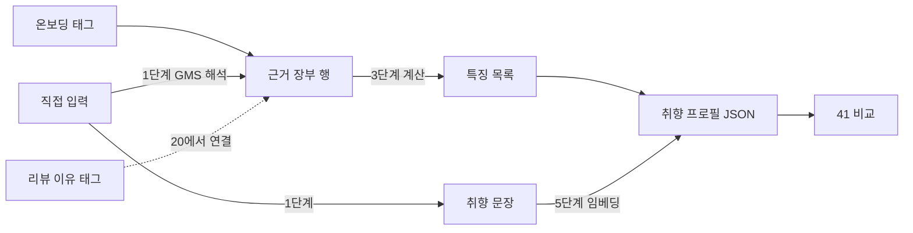

# 사용자 취향 분석 베이스라인 (taste-profile)

Status: draft · Jira: S15P31A302-39 · 관련: S15P31A302-40(가게 특징 분석), S15P31A302-41(취향-가게 비교), S15P31A302-20(취향 보정)

PRD·기술 설계와 다르면 PRD를 따른다. 확장 코드와 코드 문구는 출시 지역 데이터(2026-10-23 수집)로 다시 정했다. 가중치 상한 3처럼 검증 전 초기값은 본문에 그렇게 적었다.

## 한눈에 보기

| 항목 | 내용 |
|---|---|
| 하는 일 | 온보딩 태그와 직접 입력을 근거 장부에 처음 기록하고, 가게 특징과 비교할 수 있는 취향 프로필(JSON)을 만든다 |
| 넘기는 일 | 검색 맥락으로 근거 고르기와 비교는 41, 방향 전환 같은 보정 규칙은 20, 가게 특징 추출은 40이 맡는다 |
| 정하지 않은 것 | DB 저장 형식. 이번에는 JSON 파일까지만 만든다 |
| 완료 기준 | 출력 형식 확정, 샘플 사용자 7명의 프로필 생성 확인 |



| 단계  | 하는 일                  | 담당               |
| --- | --------------------- | ---------------- |
| 0   | 입력과 어휘(코드표) 정하기       | 39               |
| 1   | 직접 입력을 LLM(GMS)로 해석하기 | 39               |
| 2   | 근거 장부에 기록하기           | 39 (보정 규칙은 20)   |
| 3   | 특징별 상태 계산하기           | 39               |
| 4   | 검색 맥락에 맞게 근거 고르기      | 41               |
| 5   | 비교할 수 있는 형태로 바꾸기      | 39 (합치기와 비교는 41) |
| 6   | JSON으로 출력하기           | 39               |

## 0단계. 입력과 어휘

### 층

특징 코드는 네 층으로 나눈다. 앞의 셋은 PRD §2의 L1~L3이고, 음식·맛은 확장 코드를 위해 새로 둔 층이다. 이 문서는 아래 이름만 쓴다.

| 층 이름 | 코드·JSON 값 | PRD | 뜻 |
|---|---|---|---|
| 성향 축 | `axis` | L1 | 조용 ↔ 활기처럼 반대 극이 있는 취향 |
| 중요 기준 | `importance` | L2 | 사람마다 중요하게 여기는 정도가 다른 기준. 싫어하는 방향이 없다 |
| 방문 목적 | `purpose` | L3 | 대화, 혼밥, 모임처럼 자주 가는 목적. 싫어하는 방향이 없다 |
| 음식·맛 | `food` | 없음 | 음식 종류와 매운맛. 코드는 모두 직접 입력에서만 붙는다 |

시설(PRD L4)은 취향이 아니라 요청 조건 전용이라 코드표에 넣지 않는다. 코드 이름은 한 무리 안의 항목이면 층 이름을 접두어로 붙인다(`PURPOSE_`, `FOOD_`). 성향 축과 중요 기준의 코드는 단어만으로 뜻이 분명해서 붙이지 않는다.

### 온보딩 태그

온보딩은 PRD 태그 13개를 쓴다. 화면 문구는 PRD 초안을 다듬어 썼다(PRD도 문구는 조정할 수 있다고 한다). 소음 축은 극마다 코드를 하나씩 두고 서로 반대 극으로 묶는다. PRD 태그, 리뷰 이유 태그, 검색 요청의 `preferences`가 모두 극 단위라서 이렇게 해야 중간 변환이 없다.

코드표에는 문구를 두 가지 둔다. `label`은 화면에 보이는 태그 문구이고, `phrase`는 임베딩에 쓰는 문장이다. `phrase`는 화면 문구를 문장으로 다듬은 것과 네이버 키워드식 문구 중 측정 AP가 높은 쪽을 골랐다. 차이가 0.01보다 작으면 화면 문구 쪽을 쓴다. 측정 방법과 값은 5단계에 있다.

| 층   | 코드                      | label       | phrase                |
| --- | ----------------------- | ----------- | --------------------- |
| `axis` | `QUIET` (반대 극 `LIVELY`) | 조용하고 차분한 곳  | 조용하고 차분한 곳            |
| `axis` | `LIVELY` (반대 극 `QUIET`) | 활기찬 곳       | 활기찬 곳                 |
| `importance` | `SPACIOUS_SEATING`      | 자리가 넉넉한 곳   | 매장이 넓고 좌석이 편한 곳       |
| `importance` | `SHORT_WAIT`            | 웨이팅 적은 곳    | 대기가 적은 곳              |
| `importance` | `GENEROUS_PORTION`      | 양이 충분한 곳    | 양이 많아서 배부르게 먹을 수 있는 곳 |
| `importance` | `PRETTY_SPACE`          | 공간이 예쁜 곳    | 인테리어가 멋진 곳            |
| `importance` | `VIEW_OUTDOOR`          | 전망·야외가 좋은 곳 | 전망·야외가 좋은 곳           |
| `importance` | `COZY`                  | 아늑한 곳       | 아늑한 곳                 |
| `importance` | `VALUE_FOR_MONEY`       | 가성비 좋은 곳    | 가성비 좋은 곳              |
| `purpose` | `PURPOSE_TALK`          | 대화          | 대화하기 좋은 곳             |
| `purpose` | `PURPOSE_SOLO`          | 혼밥          | 혼밥하기 좋은 곳             |
| `purpose` | `PURPOSE_DATE`          | 데이트·특별한 날   | 데이트나 특별한 날에 가기 좋은 곳   |
| `purpose` | `PURPOSE_GROUP`         | 모임          | 단체 모임 하기 좋은 곳         |
| `purpose` | `PURPOSE_WORK`          | 작업·공부       | 작업이나 공부하기 좋은 곳        |

`LIVELY`와 `SHORT_WAIT`는 대응하는 네이버 키워드가 없어 AP를 잴 수 없다. 그래서 PRD 문구를 그대로 쓴다.

### 확장 코드

확장 코드는 온보딩 화면에 나오지 않는다. 직접 입력을 해석할 때만 붙는다. 맛이나 음식 종류를 받고 싶지만 온보딩에서 "매운맛 좋아하세요?"처럼 따로 묻지는 않는다. 그렇게 물으면 서비스가 매운맛만 보는 것처럼 보이기 때문이다.

확장 코드는 **가게 쪽에서 근거를 만들 수 있는 어휘**에서만 만든다. 사용자 코드는 같은 코드의 가게 근거와 맞대야 점수가 되므로, 가게 쪽에 근거가 없는 코드는 만들어도 쓸 곳이 없다. 남기는 기준은 PRD 태그와 같다. 장소별 최신 방문자 리뷰 100건 중 근거가 3건 이상인 장소가 전체의 10% 이상이어야 한다. 분모를 적는 이유는 같은 3건이라도 보는 리뷰 수에 따라 엄격함이 달라지기 때문이다. PoC는 장소당 리뷰가 약 37건이었고, 출시 지역 데이터와 40은 최신 100건을 본다.

| 층 | 코드 | label | phrase | 가게 쪽 근거 | 근거 3건+ 장소(출시 지역) |
|---|---|---|---|---|---|
| `food` | `FOOD_KOREAN` | 한식 | 한식당 | 네이버 업종 | 100% (업종은 모든 장소에 있음) |
| `food` | `FOOD_JAPANESE` | 일식 | 일식당 | 네이버 업종 | 〃 |
| `food` | `FOOD_CHINESE` | 중식 | 중식당 | 네이버 업종 | 〃 |
| `food` | `FOOD_WESTERN` | 양식 | 양식당 | 네이버 업종 | 〃 |
| `food` | `FOOD_ASIAN` | 아시안 | 아시아 음식점 | 네이버 업종 | 〃 |
| `food` | `FOOD_SPICY` | 매운 음식 | 매콤한 음식을 먹을 수 있는 곳 | 리뷰 언급(주), 메뉴명(장소당 1건) | 23% (메뉴명만으로는 5~8%) |
| `importance` | `UNIQUE_CONCEPT` | 컨셉이 독특한 곳 | 컨셉이 독특한 곳 | "컨셉이 독특해요" 키워드 | 12% |
| `importance` | `FAST_SERVING` | 음식이 빨리 나오는 곳 | 음식이 빨리 나오는 곳 | "음식이 빨리 나와요" 키워드 | 14% |
| `importance` | `GOOD_MUSIC` | 음악이 좋은 곳 | 음악이 좋은 곳 | "음악이 좋아요" 키워드 | 29% (88곳 중 74곳이 술집) |

- 음식 종류는 최상위 5개만 둔다. 고기구이나 분식은 한식의 하위 분류라 같은 층위에 둘 수 없다. 하위 분류는 코드 없이 취향 문장으로 남긴다(1단계). 네이버 세부 업종을 이 5개로 묶는 일은 40이 한다.
- 카페와 술집은 이미 업종 그룹(PRD FR-01)이라 음식 종류에 넣지 않는다.
- 음식·맛 층의 코드는 매운맛을 포함해 모두 직접 입력에서만 붙는다. 이 층은 소음 조건(성향 축 제외)이나 목적·인원(방문 목적 제외)의 영향을 받지 않는다. 요청에 음식 종류가 있으면 요청을 따른다(41이 처리).
- `FAST_SERVING`과 `GOOD_MUSIC`은 PoC에서 9%라 뺐다가 출시 지역 데이터에서 기준을 넘어 넣었다. `GOOD_MUSIC`은 근거가 거의 술집에서 나온다. 업종별 차이는 41이 다룬다.
- 보류: 건강한 맛(18%, 식당 38곳). "건강한 맛"과 직접 입력의 "담백한"이 같은 뜻인지 근거가 없다. 직접 입력 해석 샘플로 먼저 확인한다.
- 후보였지만 넣지 않은 것: 오래 머무르기 좋은 곳(11%)은 대화·작업 목적과 겹친다. 사진이 잘 나오는 곳(27%)은 공간 사진인지 음식 사진인지 분명하지 않고 근거가 카페에 몰린다. 혼술하기 좋은 곳(7%)은 기준에 못 미쳐 `PURPOSE_SOLO`로 받는다. 아이 동반, 반려동물, 룸은 타깃(20~30대 SSAFY 교육생·임직원)과 맞지 않거나 시설이라 뺐다. 고기 질, 재료 신선, 디저트·커피 맛은 PRD가 취향에서 뺀 범용 맛 품질이거나 요청으로 처리하는 항목이다.

## 1단계. 직접 입력 해석

사용자가 온보딩에서 직접 입력(최대 100자)을 쓰고 해석을 요청하면 GMS를 한 번 호출한다(PRD FR-06). 해석을 요청하지 않으면 원문도 저장하지 않는다. 해석을 요청하면 성공·실패와 상관없이 원문과 결과를 "직접 입력 기록"에 남긴다.

### GMS 호출

| 항목 | 값 |
|---|---|
| 모델 | `gpt-4o-mini`, temperature 0, strict JSON 스키마 출력(`response_format: json_schema`). JSON 모드는 스키마를 보장하지 않아 쓰지 않는다. GMS가 그대로 전달하는 것을 확인했다 |
| 접속 | 환경변수 `GMS_BASE_URL`, `GMS_API_KEY`, `GMS_ENABLED`(`docs/infra/contracts/env.md`의 이름 그대로). 주소는 기준 URL과 전체 엔드포인트를 모두 받는다 |
| 실패 | 타임아웃이 있다. 호출 실패나 출력 검사 실패면 한 번 다시 요청한다. 그래도 실패하면 해석 실패다. 온보딩은 다시 시도하게 하고 원문을 프로필에 저장하지 않는다(직접 입력 기록에는 실패로 남는다) |
| 킬스위치 | `GMS_ENABLED`가 `true`가 아니면 호출하지 않고 해석 실패로 본다 |
| 설정 오류 | 켜져 있는데 주소나 키가 비었거나 주소가 `http(s)://`로 시작하지 않으면 장애로 보지 않고 에러를 낸다. 실행을 시작할 때 검사해 배포 직후 드러나게 한다 |
| 로그 | 입력 원문과 응답 본문은 로그에 남기지 않는다. 실패 종류만 남긴다 |

온보딩 직접 입력은 AI API(아래 "해석 API")가 GMS를 부른다. AI API는 Modal에서 돌고 GMS 키는 Modal Secret에 둔다(`ai/.env.example`). 인프라 설계의 외부 서비스 표는 아직 GMS 키를 BE 서버 env에 두므로 AI API Modal 배포 때 함께 고친다.

### 프롬프트에 넣는 것

- 층의 뜻과 코드표 전체(코드, 층, label, 설명으로 `phrase`)
- 목록에 있는 코드만 쓰고, 입력에 없는 내용은 쓰지 않는다
- 입력을 의미 단위로 쪼개고, 항목 하나에는 코드를 하나만 붙인다. 예를 들어 "조용하고 넓은 곳 좋아해요"는 `QUIET` 항목과 `SPACIOUS_SEATING` 항목으로 나뉜다
- `like`는 원문 말투가 아니라 코드 설명 기준이다. 반대 상황을 싫어한다는 말은 그 코드를 원한다는 뜻이다. 예를 들어 "시끄러운 데 싫어요"는 `QUIET`, "좁은 데는 답답해요"는 `SPACIOUS_SEATING`의 `like: true`다(PRD FR-05와 같은 규칙)
- 음식 종류 코드는 "한식"처럼 종류 자체를 말할 때만 붙이고, 구체적인 메뉴나 맛은 문장으로 남긴다
- 항목 종류(`kind`)를 먼저 고른다. 시설, 범용 품질("맛있는 곳", "친절한 곳"), 예산("2만 원 이하")은 코드도 긍정형 문장도 붙이지 않는다
- 코드 없는 좋아하는 취향의 `positive_text`는 코드 `phrase`처럼 "곳"으로 끝나는 구로 쓴다. 같은 질의 공간에서 코드 문구와 비교하기 위해서다

처음에는 라벨에 설명을 붙인 단순 제로샷 지시로 두었다(Gen-Z, arXiv 2311.07115; arXiv 2412.12564). LLM은 부정 표현에 약해서(arXiv 2306.08189, 2310.15941) `like`를 코드 기준으로 정의하고 아래 코드 규칙으로 다시 검사한다.

지금 프롬프트는 이 지시를 GEPA로 최적화한 것이다(S15P31A302-107, `ai/experiments/prompt_opt/`). 부정 표현의 `like` 방향, kind 경계, 업종과 메뉴 구분, 취향 없음 처리를 예시와 함께 적은 규칙이 늘었다.

| 평가 | 값 |
|---|---|
| 평가셋 | 합성 251개(train 42 / val 101 / test 108). test 30개는 사람이 확인했다(`reviewed`) |
| 지표 | 입력마다 (kind, code, like) 집합의 자카드 유사도 평균. test를 3번 돌린 범위 |
| 최적화 전 | 0.665~0.684 |
| 최적화 후 | 0.846~0.855 |

- 최적화는 4번 돌렸다. 반성 모델(gpt-5.5, GPT-6.1 Sol)과 반성 지시(기본, 일반 규칙·길이 상한)를 바꿨다. 결과 중 셋을 test 108개로 3번씩 재서 가장 높은 것(gpt-5.5, 기본 반성 지시)을 골랐다. 다른 둘은 0.809~0.830(GPT-6.1 Sol, 기본)과 0.660~0.670(GPT-6.1 Sol, 일반 규칙·길이 상한)이었다.
- 예시 일부는 GEPA 학습 문장이고, 프롬프트는 6배 길어졌다(1,276자 → 7,702자, 코드표 제외).
- 평가셋은 시설·품질·예산의 `like`를 "그 조건을 원하면 true"로 라벨했다("주차 안 되면 싫어요" → true). 지금 프롬프트는 품질·예산에서 원문 태도를 따르는 예시("비싼 곳은 싫어요" → false)를 두어 이 라벨과 어긋난다. 이 세 종류는 `free_texts`에 원문과 `like`만 남고 벡터를 만들지 않으므로 비교 점수에는 쓰이지 않는다.
- 남은 오류: 중요 기준·방문 목적에 대한 불만을 `like: false`로 두어 코드가 떨어지는 것(불만형 test 0.65), 국밥·고깃집을 `FOOD_KOREAN`으로 붙이는 것.

### 응답 형식과 검사

```json
{"items": [{"quote": "너무 매운 건 못 먹어요", "kind": "taste", "code": "FOOD_SPICY", "like": false, "positive_text": null}]}
```

| 필드 | 뜻 |
|---|---|
| `quote` | 입력 원문에서 그대로 따온 구절. 원문에 없으면 그 항목을 버린다 |
| `kind` | `taste`, `facility`(있다/없다로 갈리는 편의 시설), `quality`(범용 품질), `budget`(예산). 스키마 enum으로 강제한다 |
| `code` | 코드표에 있는 코드 또는 `null`. 스키마 enum으로 강제하고, 코드표에 없으면 그 항목을 버린다 |
| `like` | 코드 설명 같은 곳을 원하는지(`true`) 피하고 싶은지(`false`) |
| `positive_text` | 코드가 없는 취향을 긍정형으로 정리한 구 또는 `null` |

필드 순서는 종류와 코드를 먼저 고르고 그 코드 기준으로 `like`를 정하게 둔다.

`quote`를 원문과 대조해 LLM이 입력에 없던 취향을 지어내지 못하게 한다(기술 설계 §3.6, EXP3RT의 "리뷰에 없는 내용은 쓰지 말 것"과 같은 원칙). 빈 문자열이나 공백뿐인 `quote`는 어떤 원문에도 들어 있으므로 버린다.

LLM이 준 항목이 대조에서 모두 버려지면 출력 검사 실패로 본다. 예를 들어 `quote` 끝에 마침표를 붙이는 형식 실수로 취향을 잃지 않게 한 번 다시 요청하고, 그래도 실패하면 해석 실패다. LLM이 처음부터 빈 목록을 주면(해석할 취향이 없다는 판단) 정상 결과다.

다음 세 경우는 LLM의 판단을 그대로 믿지 않고 코드 규칙으로 다시 정한다.
- `positive_text`는 `kind: taste`이고 `like: true`일 때만 남긴다. 시설·품질·예산과 싫어하는 문장은 LLM이 문장을 써도 버리고 원문만 보관한다. 조건부 지시만으로는 시설 문장에 `positive_text`가 붙는 것을 막지 못했다.
- 반대 극이 있는 코드에 `like: false`가 오면 반대 극 코드의 `like: true`로 바꾼다. 예를 들어 "활기찬 데 싫어요"(`LIVELY`, false)는 `QUIET`(true)이 된다.
- 중요 기준·방문 목적 코드에 `like: false`가 오면 코드를 떼고 문장으로만 보관한다. PRD상 이 두 층에는 싫어하는 방향이 없다(D-06).

### 해석 결과가 가는 곳

| 경우 | 처리 | 예시 |
|---|---|---|
| 기존 코드에 연결 | 근거 장부에 +1 | "시끄럽지 않은 데가 좋아요" → `QUIET` +1 |
| 확장 코드에 연결 | 근거 장부에 +1. 음식·맛 코드는 싫어하면 −1 | "너무 매운 건 못 먹어요" → `FOOD_SPICY` −1 |
| 코드 없는 취향 | 긍정형 문장을 벡터와 함께 저장 | "점심엔 담백한 국물 요리가 좋아요" → "담백한 국물 요리를 먹을 수 있는 곳"처럼 정리해 저장 |
| 보관만 | 벡터 없이 저장 | 시설, 범용 품질, 예산, 싫어하는 문장 |
| 해석 실패 | 프로필에 저장하지 않는다(직접 입력 기록에만 남는다). 사용자가 그 자리에서 다시 시도하고, 고른 태그가 있으면 태그만으로 시작할 수 있다. 실패가 드물고, 나중에 배치가 해석하면 사용자가 칩을 확인하고 지우는 단계(PRD FR-06)를 거치지 않아 해석 대기를 두지 않는다 | GMS 장애, 출력 검사 두 번 실패 |

보관만 하는 문장에 이유를 따로 적지 않는다. 지금은 저장만 해 두고 고도화할 때 어떤 데이터가 쌓였는지 보고 판단한다.

임베딩은 부정을 구분하지 못한다. 그래서 싫어하는 문장은 벡터로 만들지 않는다. arctic-ko에서 "매운 음식을 좋아해요"와 "매운 음식을 싫어해요"의 코사인 유사도는 0.895였다. 그대로 넣으면 "매운 걸 좋아한다"와 거의 같게 반영된다.

### 칩 표시

해석 결과는 칩으로 보여 주고 사용자가 지울 수 있다(PRD FR-06).
- 코드가 있으면 `label`을 보여 준다
- 코드가 없으면 `positive_text`를 보여 준다. 둘 다 없는 선호 취향은 1단계 검사에서 다시 요청하므로 생기지 않는다
- 보관만 하는 항목은 칩에서 뺀다. 보여 주면 반영된다고 오해할 수 있다

### 해석 API

BE `TasteAnalyzer`가 직접 입력마다 AI API를 한 번 부른다(`ai/server/direct_input.py`). 칩 규칙은 위 "칩 표시"를 따르고 `fit_ai.taste.direct_input.to_chips`가 만든다.

`POST /v1/taste/interpret`

```json
{"text": "시끄럽지 않은 데가 좋아요. 너무 매운 건 못 먹어요"}
```

| 요청 필드 | 규칙 |
|---|---|
| `text` | 앞뒤 공백을 지운 뒤 1~100자. 모르는 필드는 거부한다 |

```json
{"tastes": [{"polarity": "LIKE", "label": "조용하고 차분한 곳", "code": "QUIET"},
            {"polarity": "DISLIKE", "label": "매운 음식", "code": "FOOD_SPICY"}],
 "model": "gpt-4o-mini"}
```

| 응답 필드 | 뜻 |
|---|---|
| `tastes` | 칩 목록, 최대 10개. 해석할 취향이 없으면 빈 목록(200)이다. 해석 실패와 구분한다 |
| `tastes[].polarity` | `LIKE` 또는 `DISLIKE`. `DISLIKE`는 음식·맛 코드에만 나온다(1단계 규칙) |
| `tastes[].label` | 코드가 있으면 코드표 `label`, 없으면 `positive_text`. BE 상한에 맞춰 공백을 하나로 줄이고 UTF-16 20단위로 자른다 |
| `tastes[].code` | 코드표 코드 또는 `null`. BE가 칩과 함께 저장한다(profile-storage spec 열린 문제 6) |
| `model` | 해석한 LLM |

오류는 BE 컨벤션의 ProblemDetail(`application/problem+json`, `code` 필드)이다. 입력 원문은 응답과 로그에 넣지 않고, 로그에는 칩 수와 걸린 시간만 남긴다.

| 상태 | `code` | 경우 |
|---|---|---|
| 400 | `INVALID_REQUEST` | 본문이 JSON이 아니거나 `text`가 규칙에 맞지 않음, 모르는 필드 |
| 503 | `INTERPRET_FAILED` | GMS가 꺼짐(`GMS_ENABLED`), 호출이나 출력 검사가 두 번 실패. 사용자가 다시 시도한다 |
| 500 | `INTERNAL_ERROR` | 예상하지 못한 오류 |

GMS 한 번의 타임아웃은 `GMS_TIMEOUT_SECONDS`(기본 5초)이고 실패하면 한 번 더 부른다. 실제 GMS로 부르면 지금 프롬프트에서 2.2~3.0초(입력 4개) 걸렸다. 최적화 전 프롬프트는 1.1~1.9초였다. BE 기본 타임아웃(`fitdining.onboarding.timeout-ms`, 3초)에 걸리므로 BE에 연결할 때 함께 정한다.

해석 품질 평가(정답셋 만들기)는 이번 범위가 아니다. 샘플 입력으로 동작만 확인한다.

### 직접 입력 기록

BE가 해석을 마칠 때마다 `taste_input_logs`에 한 줄을 남긴다(V15). 실제 입력으로 해석 품질을 확인하고, 프롬프트를 바꾼 뒤 다시 해석하는 데 쓴다.

| 항목 | 값 |
|---|---|
| 남기는 것 | 원문(`text`), 해석된 칩(`tastes`, 실패면 `NULL`), AI API가 알려 준 모델(`model`, 실패면 `NULL`), 성공 여부, 시각 |
| 남기는 때 | 해석까지 간 요청마다. 분석기 오류, 타임아웃, 대기열 초과는 실패로 남는다. 시도 제한(429)과 입력 검사(400)에 걸린 요청은 해석 전이라 남기지 않는다 |
| 대상 | 회원·비회원 모두. 회원 ID와 IP를 넣지 않아 누구의 입력인지 알 수 없다. 그래서 탈퇴해도 지우지 않고 보관 기간이 지나야 지워진다 |
| 보관 | 90일. `AuthCleanup`이 10분마다 지난 행을 지운다(`auth.cleanup.taste-input-retention`) |
| 기록 실패 | 기록은 응답과 따로 스레드 하나가 쓴다. DB가 느리거나 실패해도 해석 응답은 기다리지 않고 그대로 보낸다. 쓰기 대기가 100줄을 넘거나 서버가 내려가면 그 줄은 버린다. 애플리케이션 로그에는 예외 종류만 남기고 원문은 남기지 않는다 |

기록과 회원 연결, 기록으로 다시 해석하는 배치는 아직 없다.

## 2단계. 근거 장부

근거 장부는 사용자가 한 일을 한 줄씩 쌓은 원본 기록이다(PRD §2). 계산 결과가 아니라 사실만 적어야 리뷰 삭제나 규칙 변경 뒤에 다시 계산할 수 있다.

### 행 필드

| 필드 | 뜻 | 예 |
|---|---|---|
| `user_id` | 회원 ID. 비회원은 비운다 | `u1` |
| `code` | 특징 코드. 코드 없는 취향 문장은 비운다 | `QUIET` |
| `direction` | `+1` 또는 `−1` | `+1` |
| `source` | `onboarding`, `review`, `free_text` | `review` |
| `place_id` | 리뷰 근거일 때 장소 | `1114913849` |
| `review_id` | 리뷰 근거일 때 리뷰 | `r-...` |
| `category` | 리뷰 근거일 때 업종(식당, 카페, 술집) | `카페` |
| `quote` | 직접 입력 근거일 때 원문 구절 | `시끄럽지 않은 데가 좋아요` |
| `positive_text` | 코드 없는 취향 문장일 때 긍정형 구 | `담백한 국물 요리를 먹을 수 있는 곳` |
| `created_at` | 기록 시각(ISO 8601, 시간대 포함) | `2026-10-22T10:00:00+09:00` |

직접 입력 원문 전체는 행이 아니라 프로필의 `original_text`에 한 번 둔다. 프롬프트를 바꾼 뒤 다시 해석할 때 필요하다.

### 기록 규칙

| 입력 | 기록 |
|---|---|
| 온보딩 태그 선택 | 고른 태그마다 그 코드 +1. 고르지 않은 태그는 기록하지 않는다(비선호가 아님) |
| 리뷰 이유 태그 | 그 태그가 지지하는 극이나 코드에 +1. 아래 표 참고 |
| 직접 입력의 코드 | 좋아하면 +1. 싫어하면 음식·맛 코드만 −1이고, 나머지는 1단계 규칙대로 반대 극 +1이나 문장으로 바꾼다. 한 입력에서 같은 코드는 한 번만 |
| 직접 입력의 문장 | `code` 없이 `positive_text` 또는 `quote`와 함께 기록 |

리뷰 이유 태그는 항상 +1이다. 빼는 쪽은 3단계 계산에서 반대 극으로 나온다. 반대 극이 없는 음식·맛 코드를 싫어할 때만 장부에 −1이 직접 들어간다.

| 리뷰 이유 태그 | 기록 | 3단계 계산 결과 |
|---|---|---|
| 조용해서 좋았어요 | `QUIET` +1 | 조용 쪽 +1, 활기 쪽 −1 |
| 너무 시끄러웠어요 | `QUIET` +1 | 시끄러워서 아쉬웠다는 건 조용함을 원한다는 뜻 |
| 활기차서 좋았어요 / 너무 썰렁했어요 | `LIVELY` +1 | 활기 쪽 +1, 조용 쪽 −1 |
| 자리가 넉넉했어요 / 자리가 좁았어요 | `SPACIOUS_SEATING` +1 | 아쉬웠다는 평가도 그 기준을 중요하게 여긴다는 근거(D-06) |

이 규칙은 리뷰 담당에게 공유한다. 리뷰 이유 태그가 특징 코드를 하나씩 참조하는 구조(리뷰 spec D-16)와 맞는다.

### 경계

- 비회원도 같은 계산을 쓴다. 기기가 온보딩과 해석된 직접 입력을 저장했다가 검색 요청에 실어 보내고, 서버는 비회원의 프로필을 저장하지 않는다(PRD FR-07, 기술 설계 §4.1). 직접 입력 원문과 해석 결과는 회원과 같이 "직접 입력 기록"에 90일 남는다.
- 삭제된 리뷰, 분석 제외된 리뷰, 탈퇴한 사용자의 행은 계산 함수에 넘기기 전에 호출하는 쪽이 거른다. 계산 함수는 받은 행을 모두 유효한 근거로 본다. 그래서 유일한 근거가 사라지면 그 특징은 자연히 빠진다(PRD FR-11).
- 방향 전환 같은 보정 규칙은 20의 일이다. 이번에는 온보딩과 직접 입력을 장부에 처음 기록하는 데까지 만든다. 리뷰 행은 계산 규칙을 확인하는 샘플에만 손으로 만들어 넣는다.

## 3단계. 특징별 상태 계산

장부 행을 받아 특징마다 좋아하는지, 얼마나 강한지를 정한다. LLM은 쓰지 않는다.

### 계산 순서

1. **같은 장소는 최신 평가 하나만 센다.** 리뷰 근거는 장소마다 특징별로 `created_at`이 가장 늦은 행 하나만 남긴다. 소음 축은 `QUIET`과 `LIVELY`를 같은 특징으로 본다(PRD FR-14).
2. **근거를 센다.** 코드마다 긍정 근거 − 부정 근거를 구한다. 소음 축은 `QUIET` 근거 − `LIVELY` 근거로 한 번에 센다.
3. **소음 축의 방향을 정한다.** 온보딩에서 극을 골랐으면 그 극으로 고정한다. 고르지 않았으면 리뷰 근거의 부호를 따른다.
4. **가중치를 정한다.** 가중치는 min(긍정 근거 − 부정 근거, 3)이다. 0 이하면 특징에서 뺀다. 상한 3은 검증 전 초기값이다(PRD OQ-11).
5. **싫어하는 특징을 만든다.** 소음 축은 반대 극을 같은 가중치의 `like: false`로 둔다. 반대 극이 없는 코드는 값이 음수이면 `like: false`, 가중치는 min(부정 근거 − 긍정 근거, 3)이다. 중요 기준과 방문 목적에는 싫어하는 특징이 생기지 않는다.
6. **취향 문장을 정리한다.** 코드 없는 문장은 가중치 1로 고정하고, 똑같은 문장은 하나로 합친다(기술 설계 §4.2).

근거 수만으로 방향을 정하면 리뷰 한두 번에 방향이 뒤집힌다. 그래서 소음 축 방향을 온보딩 극으로 고정한다. PRD는 "한 번의 평가로 선호 방향을 뒤집지 않는다", "반대 평가가 서로 다른 장소 3곳 이상이고 과반이면 바꾼다"고 정한다. 바꾸는 규칙은 20에서 넣고, 그 전까지는 반대 평가가 쌓이면 강도만 0까지 낮아진다.

### 계산 예

| 상황 | 계산 | 결과 |
|---|---|---|
| 온보딩에서 조용 선택 | 조용 1 − 활기 0 = 1 | `QUIET` 좋아함 1, `LIVELY` 싫어함 1 |
| 온보딩 조용 + 카페 4곳에서 "조용해서 좋았어요" | 1 + 4 = 5 | `QUIET` 좋아함 3(상한), `LIVELY` 싫어함 3 |
| 같은 카페 한 곳에 "조용해서 좋았어요" 5번 | 그 장소는 최신 1번만 셈 → 1 | 단골 한 곳이 상한을 혼자 채우지 못한다 |
| 온보딩 조용 + 다른 장소 2곳에서 "활기차서 좋았어요" | 1 − 2 = −1, 방향은 조용으로 고정 | 소음 취향 없음(좋아함·싫어함 모두 없음) |
| 온보딩 조용 + 직접 입력 "활기찬 곳 좋아요" | 1 − 1 = 0 | 소음 취향 없음. 칩을 보고 사용자가 한쪽을 지울 수 있다 |
| 직접 입력 "너무 매운 건 못 먹어요" | 0 − 1 = −1 | `FOOD_SPICY` 싫어함 1 |

### 이번에 넣지 않은 것

| 후보 | 내용 | 다룰 곳 |
|---|---|---|
| 방향 전환 | 반대 평가 3곳 이상, 과반이면 방향을 바꾼다 | 20 |
| 확률 모델 | 특징마다 Beta(1 + 긍정 근거, 1 + 부정 근거)로 선호 정도와 불확실성을 함께 구한다. 위 규칙 여러 개를 식 하나로 바꿀 수 있다 | 20의 실험 후보 |
| IUF | 많은 사람이 고르는 태그의 가중치를 낮춘다(Breese 외 1998). 사용자 분포가 쌓여야 계산할 수 있다 | 출시 후 |

## 4단계. 검색 맥락에 맞게 근거 고르기 (41 담당)

검색 요청에 따라 쓸 근거를 고르는 일은 요청이 있어야 할 수 있어서 41이 맡는다. 39는 근거 행에 업종과 층을 남겨 41이 고를 수 있게만 한다.

41이 다룰 것:
- 요청에 목적이나 인원이 있으면 방문 목적(`purpose`)을 빼고, 소음 조건이 있으면 소음 취향과 소음 비선호를 뺀다(PRD AC-28, AC-30)
- 요청 업종이 정해졌을 때 그 업종 근거만 쓸지(기술 설계 §4.2), 다른 업종 근거를 낮은 가중치로 남길지 비교한다. 출시 직후에는 근거 대부분이 업종 없는 온보딩 근거라 차이가 작다
- 요청에 음식 종류가 있으면 음식·맛(`food`) 취향보다 요청을 따른다

## 5단계. 비교할 수 있는 형태로 바꾸기

### 특징 목록

3단계 결과를 그대로 `features`로 내보낸다. 41은 이 목록으로 가게 태그 라벨과 코드끼리 직접 맞출 수 있다. 출시 지역 리뷰로 측정해 보니 "아늑", "조용", "데이트", "빨리 나와요"는 문구로 리뷰를 검색해도 무작위보다 조금 나은 정도였다(AP 0.045 대 무작위 0.026, 0.044 대 0.028, 0.035 대 0.013, 0.034 대 0.015). 이런 태그는 벡터보다 코드 매칭이 믿을 만하다.

### 벡터

| 항목 | 값 |
|---|---|
| 모델 | `dragonkue/snowflake-arctic-embed-l-v2.0-ko`, 리비전 `55ec6e9358a56d56af759bc8372e970caf8c305f` 고정 |
| 취향 쪽 인코딩 | 질의(문장 앞에 `query: `를 붙여서 인코딩) |
| 정리 | 길이가 1이 되게 정규화(L2 노름), 소수 6자리 반올림 |
| 코드 문구 벡터 | 모든 사용자에게 같으므로 사용자마다 넣지 않고 `code_vectors.json` 파일 하나로 둔다 |
| 취향 문장 벡터 | 프로필을 만들 때 계산해 `free_texts`에 넣는다. DB에는 칩마다 `user_preferences.tastes[].vector`로 둔다(profile-storage) |

벡터를 하나로 합치거나 페르소나와 비교하는 일은 41이 한다.

**질의와 문서.** arctic-ko에는 검색하는 쪽 문장(질의)과 검색 대상 글(문서)을 서로 다르게 넣는다. 질의에만 `query: `를 붙이고 문서에는 붙이지 않는다. 원본 모델(Snowflake)과 한국어 모델의 카드가 모두 이렇게 안내한다. 붙이는 글자는 임베딩하기 전에 문장 앞에 넣는 것이라 붙이면 벡터 자체가 달라진다. 같은 문장이라도 붙인 벡터와 안 붙인 벡터의 코사인 유사도는 0.78~0.87이었다.

| 쓰임 | 질의 쪽 (붙임) | 문서 쪽 (안 붙임) | 담당 |
|---|---|---|---|
| 후보 검색 | 긍정형 요청문 | 장소 요약, 페르소나 | 검색 |
| 요청 적합도 | 긍정형 요청문 | 장소 요약 25% + 페르소나 최대 유사도 75% | 검색 |
| 취향 점수 | 코드 문구, 취향 문장 | 만족 페르소나 최대 유사도 | 41 |
| 합산 | — | 요청 70% + 취향 30% | 41·검색 |

1차 설계에서 취향은 후보를 찾는 데 쓰지 않고, 찾은 후보를 다시 매기는 데만 쓴다. 이 구조는 요청을 장기 취향보다 우선한다는 원칙(PRD FR-08)과 맞는다. 질의용·문서용 인코딩은 공유 모듈 `embedding.py`에 함수 두 개로 두어 40과 41이 짝을 틀리지 않게 한다.

취향을 질의로 넣는 근거:
- 코드 문구로 출시 지역 네이버 리뷰 25,958건(10자 이상)을 검색했다. 정답은 그 코드의 키워드에 투표한 리뷰이고, 코드는 키워드가 있는 15개다. 평균 AP는 질의로 넣으면 0.150/0.155(화면 문구 기반/키워드식 문구), 안 붙이면 0.127/0.125였다. PoC(리뷰 3,748건)에서도 0.177/0.185 대 0.154/0.158로 같은 방향이었다
- 코드별 AP는 다음과 같다. 굵은 값이 고른 문구다

| 코드 | 무작위 | 화면 문구 기반 | 키워드식 문구 |
|---|---|---|---|
| `QUIET` | 0.028 | **0.044** 조용하고 차분한 곳 | 0.044 차분한 분위기의 곳 |
| `SPACIOUS_SEATING` | 0.186 | 0.222 자리가 넉넉한 곳 | **0.241** 매장이 넓고 좌석이 편한 곳 |
| `GENEROUS_PORTION` | 0.123 | 0.159 양이 충분한 곳 | **0.188** 양이 많아서 배부르게 먹을 수 있는 곳 |
| `PRETTY_SPACE` | 0.290 | 0.418 공간이 예쁜 곳 | **0.445** 인테리어가 멋진 곳 |
| `VIEW_OUTDOOR` | 0.030 | **0.122** 전망·야외가 좋은 곳 | 0.130 뷰가 좋고 야외 공간이 멋진 곳 |
| `COZY` | 0.026 | **0.045** 아늑한 곳 | 0.041 아늑한 분위기의 곳 |
| `VALUE_FOR_MONEY` | 0.155 | **0.247** 가성비 좋은 곳 | 0.244 가성비가 좋고 가격만큼 가치 있는 곳 |
| `UNIQUE_CONCEPT` | 0.010 | **0.056** 컨셉이 독특한 곳 | 0.048 독특한 컨셉의 공간 |
| `PURPOSE_TALK` | 0.136 | **0.267** 대화하기 좋은 곳 | 0.266 편하게 이야기 나누기 좋은 곳 |
| `PURPOSE_SOLO` | 0.039 | **0.109** 혼밥하기 좋은 곳 | 0.077 혼자 가서 먹기 좋은 곳 |
| `PURPOSE_DATE` | 0.013 | **0.035** 데이트나 특별한 날에 가기 좋은 곳 | 0.042 특별한 날 가기 좋은 곳 |
| `PURPOSE_GROUP` | 0.111 | 0.215 모임 하기 좋은 곳 | **0.242** 단체 모임 하기 좋은 곳 |
| `PURPOSE_WORK` | 0.019 | **0.145** 작업이나 공부하기 좋은 곳 | 0.137 집중해서 작업하기 좋은 곳 |
| `FAST_SERVING` | 0.015 | **0.034** 음식이 빨리 나오는 곳 | 0.035 주문하면 음식이 금방 나오는 곳 |
| `GOOD_MUSIC` | 0.053 | **0.134** 음악이 좋은 곳 | 0.142 음악이 좋고 분위기 있는 곳 |

- 확장 코드는 PRD 문구가 없어 label을 첫 후보로 두었다. 키워드식 후보 중 일부는 이번 측정을 위해 새로 만든 문구라, 표현을 바꾸면 값이 달라질 수 있다
- 다만 "취향 ↔ 페르소나"는 양쪽 다 짧은 설명문이라 둘 다 문서로 넣는 방식이 나을 수도 있다. 페르소나가 아직 없어 재지 못했다. 41에서 목데이터로 비교한다. 방식이 바뀔 수 있으므로 출력에 `prompt`를 기록한다

**임베딩 모델 비교.** 최신 한국어 임베딩 모델 13개를 같은 과제(PoC 리뷰 3,748건)로 재 보니 arctic-ko를 확실히 앞선 dense 모델이 없었다.
- PIXIE-Rune-v1.5만 키워드 과제에서 +0.003 앞섰지만 유의하지 않았다(Holm 보정 후 p=0.072)
- KURE-v3, Qwen3-Embedding-0.6B, Nemotron-3-Embed-1B는 비슷하거나 낮았고 인코딩이 3배 이상 느렸다
- late-interaction 모델(KURE-v2, colbert-ko-en-v2)은 키워드 과제에서만 앞섰다. 실제 앱 문구 과제에서는 차이가 없었고 리뷰 하나가 벡터 수십 개라 OpenSearch 단일 벡터 k-NN에 바로 올릴 수 없다

## 6단계. 출력

### 취향 프로필 JSON (`taste-profile/v0`)

```json
{
  "schema": "taste-profile/v0",
  "user_id": "u5",
  "original_text": "너무 매운 건 못 먹어요",
  "embedding": {
    "model": "dragonkue/snowflake-arctic-embed-l-v2.0-ko",
    "revision": "55ec6e9358a56d56af759bc8372e970caf8c305f",
    "prompt": "query"
  },
  "features": [
    {"code": "PURPOSE_GROUP", "layer": "purpose", "like": true, "weight": 1},
    {"code": "FOOD_SPICY", "layer": "food", "like": false, "weight": 1}
  ],
  "free_texts": [],
  "evidence": [
    {"user_id": "u5", "code": "PURPOSE_GROUP", "direction": 1, "source": "onboarding", "created_at": "..."},
    {"user_id": "u5", "code": "FOOD_SPICY", "direction": -1, "source": "free_text", "quote": "너무 매운 건 못 먹어요", "created_at": "..."}
  ]
}
```

| 필드 | 내용 |
|---|---|
| `features` | `{code, layer, like, weight}`. 좋아함과 싫어함을 `like`로 구분해 한 목록에 둔다 |
| `free_texts` | `{text, like, vector}`. 벡터가 없는 문장(`vector: null`)은 보관만 한다 |
| `evidence` | 2단계의 장부 행. 41이 업종이나 출처로 근거를 고를 때 쓴다 |
| `embedding` | 모델, 리비전, 취향 쪽 인코딩 방식 |

`code_vectors.json`은 `{model, revision, prompt, vectors: {코드: 벡터}}` 형식이다. 운영에서는 같은 벡터를 DB `feature_codes.vector`에 둔다. 사용자 취향의 DB 저장 형식과 함께 [profile-storage](../profile-storage/spec.md)에 있다.

### 프로필 계산 API

BE가 온보딩 취향을 저장할 때 AI API(`ai/server/taste_profile.py`)를 한 번 불러 `features`를 받고, `user_preferences.features`에 저장한다. 3단계 계산만 하고 GMS와 임베딩은 쓰지 않는다. 코드 없는 칩의 벡터는 아래 칩 벡터 API로 따로 받는다.

`POST /v1/taste/profile`

```json
{
  "mood": "QUIET",
  "priorities": ["VALUE"],
  "purposes": ["WORK_STUDY"],
  "tastes": [
    {"polarity": "DISLIKE", "label": "매운 음식", "code": "FOOD_SPICY"},
    {"polarity": "LIKE", "label": "담백한 국물 요리를 먹을 수", "code": null}
  ]
}
```

| 필드 | 뜻 |
|---|---|
| `mood` | BE `Preferences.Mood`. 없으면 `null`이나 생략 |
| `priorities`, `purposes` | BE `Preferences.Priority`, `Purpose` 이름. 생략하면 빈 목록 |
| `tastes` | 해석 API가 준 칩 `{polarity, label, code}`. 다른 속성(`vector` 등)은 받지 않는다. `code`는 없으면 `null`이나 생략. `code`가 있는 칩만 계산에 쓴다. `LIKE`는 +1, `DISLIKE`는 −1 |

BE 태그 이름은 코드표와 달라서(profile-storage 문제 8) 이 API에서 바꾼다. `SPACIOUS` → `SPACIOUS_SEATING`, `VALUE` → `VALUE_FOR_MONEY`, `CONVERSATION` → `PURPOSE_TALK`, `SOLO` → `PURPOSE_SOLO`, `DATE` → `PURPOSE_DATE`, `GATHERING` → `PURPOSE_GROUP`, `WORK_STUDY` → `PURPOSE_WORK`이고 나머지는 같다.

응답 `200`: `{"features": [{"code": "QUIET", "layer": "axis", "like": true, "weight": 1}, ...]}`. 근거가 없으면 빈 목록이다.

| 오류 | `code` | 경우 |
|---|---|---|
| 400 | `INVALID_REQUEST` | 모르는 태그·코드·속성, JSON 형식 오류 |
| 500 | `INTERNAL_ERROR` | 그 밖의 오류 |

오류 응답은 BE ProblemDetail 모양(`application/problem+json`)이다. 요청 내용은 응답과 로그에 넣지 않고, 로그에는 특징 개수만 남긴다. 샘플 사용자 1~6번의 요청이 `profiles.json`과 같은 `features`를 내는지 `ai/tests/server/test_taste_profile.py`가 확인한다. 7번은 리뷰 근거라 배치 몫이다.

### 칩 벡터 API

BE가 가입 때 코드 없는 `LIKE` 칩의 `label`을 한 번에 보내 벡터를 받고 `user_preferences.tastes[].vector`에 저장한다(`ai/server/taste_vectors.py`). 프로필 계산 API와 따로 둬서 임베딩이 실패해도 `features`는 저장된다. 인코딩은 `fit_ai.embedding.encode_queries`(질의, `query: `)이고 서버에서는 Modal `/embed`를 부른다. BE는 Modal 키를 갖지 않는다.

`POST /v1/taste/vectors` `{"texts": ["담백한 국물 요리를 먹을 수"]}` → `200` `{"model": "<이름>@<리비전>", "vectors": [[...1024개]]}`. `vectors`는 `texts`와 같은 순서다.

| 오류 | `code` | 경우 |
|---|---|---|
| 400 | `INVALID_REQUEST` | `texts`가 0개나 10개 초과, 공백뿐이거나 20자 초과인 문장. 칩 상한으로 막아 범용 임베딩 통로가 되지 않게 한다 |
| 503 | `EMBEDDING_UNAVAILABLE` | `EMBED_*` 설정이 없거나 Modal 호출이 실패 |

BE는 프로필 계산과 같은 스위치(`TASTE_PROFILE_ENABLED`)와 타임아웃(3초)을 쓰고, 실패하면 `vector`를 `null`로 두고 가입을 계속한다. 콜드 스타트(17~85초)에 걸리면 실패하므로 빈 벡터는 `ai/scripts/backfill_taste_vectors.py`로 채운다.

### 샘플 사용자

샘플 하나가 PRD 규칙 하나를 확인한다. 직접 입력 문구는 SSAFY 교육생과 임직원이 쓸 법한 말로 썼다.

| # | 사용자 | 입력 | 확인할 PRD 규칙 | 기대 결과 |
|---|---|---|---|---|
| 1 | 교육생 | 조용, 작업·공부 | 태그만으로 온보딩 완료(AC-01), 소음 축 반대 극은 비선호(FR-06) | `QUIET` 좋아함 1, `LIVELY` 싫어함 1, `PURPOSE_WORK` 좋아함 1 |
| 2 | 코치 | 대화, 가격만큼 만족 | 고르지 않은 태그는 비선호가 아님(FR-06) | 싫어하는 특징 없음 |
| 3 | 교육생 | 데이트 + "시끄럽지 않은 데가 좋아요" | 태그에 연결되는 부분은 근거, 부정은 긍정형으로(FR-05·06) | `QUIET` +1(`free_text`) |
| 4 | 교육생 | 혼밥 + "점심엔 담백한 국물 요리가 좋아요" | 연결되지 않는 선호 문장은 원문 그대로 반영(FR-06) | 취향 문장 + 벡터 |
| 5 | 교육생 | 모임 + "너무 매운 건 못 먹어요" | 직접 입력에서 나온 비선호(FR-06, OQ-26) | `FOOD_SPICY` 싫어함 1 |
| 6 | 강사 | 활기 + "프로젝트 끝나고 시끌벅적하게 한잔하는 곳" | 해석이 실패하면 원문을 저장하지 않고 태그만 씀 | `free_texts` 없음, 태그 근거만 |
| 7 | 1번 교육생 | 1번 + 카페 4곳 "조용해서 좋았어요", "대기가 길었어요" 1건 | 리뷰 근거, 같은 장소 최신 1건, 가중치 상한(FR-10·14, D-06) | `QUIET` 3, `SHORT_WAIT` +1, 행마다 업종 기록 |

6번은 GMS를 실제로 실패시키지 않고 테스트에서 가짜 응답으로 재현한다. 샘플 출력은 `ai/samples/taste/`에 만들고, 커밋은 따로 정한다.

## 구현 구성

```
ai/
├─ pyproject.toml, uv.lock, .python-version(3.12), .env.example
├─ src/fit_ai/
│  ├─ features.py      # 코드표: 코드, 층, label, phrase (39가 관리하고 40·41과 공유)
│  ├─ embedding.py     # arctic-ko, 질의용·문서용 인코딩, 모델은 필요할 때 로드 (공유)
│  ├─ gms.py           # GMS 호출: 타임아웃, 재시도, 킬스위치, 원문 로그 금지 (공유)
│  └─ taste/
│     ├─ profile.py       # 장부 행 → 프로필 (3·5·6단계)
│     └─ direct_input.py  # 직접 입력 → 장부 행 (1·2단계), 칩
├─ server/              # AI API(FastAPI)와 임베딩 Modal 앱. direct_input.py가 해석 API, taste_profile.py가 프로필 계산 API
├─ scripts/build_sample_taste_profiles.py
├─ samples/taste/       # profiles.json, code_vectors.json
└─ tests/
```

- uv 프로젝트이고 의존성은 `sentence-transformers`, `numpy`, `httpx`, `psycopg`, 서버용 `fastapi`, 개발용 `pytest`, `ruff`, `uvicorn`, `modal`, `pgserver`다. ruff는 lefthook pre-commit에서 스테이징한 `ai/` 파일에 돈다
- torch는 기본으로 PyPI 빌드를 쓴다. GPU 서버(CUDA 12.8 드라이버)에서는 `uv sync --extra cu128`, CPU 전용 빌드는 `uv sync --extra cpu`로 고른다
- 40은 `place/`, 41은 `match/`를 쓴다. 41은 `taste` 내부를 가져다 쓰지 않고 프로필 JSON만 읽는다
- 코드표는 지금 Python 모듈이다. BE·FE가 같은 목록을 읽어야 할 때(공용 특징 코드 목록, 리뷰 spec D-16) JSON으로 옮긴다
- 넣지 않는 것: `ai/` CI 잡, Docker. 저장소 전체에 도는 시크릿 검사와 줄바꿈(CRLF) 검사는 `ai/`에도 적용된다
- 단위 테스트는 임베딩 함수와 GMS 응답을 가짜로 넣어 모델과 네트워크 없이 돈다. 실제 모델과 GMS 확인은 샘플 생성 스크립트로 한다

## 열린 질문

| 질문 | 누가 | 언제 |
|---|---|---|
| 공용 특징 코드 목록은 누가 관리하나. 코드표를 JSON으로 옮길 시점 | 팀 | 리뷰 1차 후속 전 |
| 리뷰 이유 태그 → 코드 기록 규칙(2단계) 공유와 확인 | 리뷰 담당 | 리뷰 1차 후속 전 |
| 운영에서 GMS를 누가 부르나(AI 쪽이면 인프라 계약 수정), 처리방침의 외부 전송 항목(PRD OQ-05) | 인프라·AI | 직접 입력 기능 연결 전 |
| 건강한 맛 코드를 넣을지("담백한" 같은 직접 입력과 같은 뜻인지) | 39 | 직접 입력 해석 샘플 확인 후 |
| 취향을 질의로 넣을지 문서로 넣을지, 업종 필터를 쓸지, 벡터를 합치는 방식 | 41 | 비교 베이스라인 |
| 비선호 감점과 주의점의 가게 쪽 근거 부족. 출시 지역 기준 `LIVELY` 쪽(시끄러움·활기 언급, 부정형 제외) 근거 3건 이상 20곳(7%), `QUIET` 쪽 83곳(28%), 소음 근거가 없는 장소 68%. 사용자 쪽 소음 규칙은 바꾸지 않는다 | 40·41 | 비교 베이스라인 |
| 방향 전환, 확률 모델, IUF | 20 | 취향 보정 |
| 리뷰 행의 `created_at`에 시간대가 없을 때. 같은 장소 최신 1건을 고를 때 시간대가 있는 행과 섞이면 계산이 멈춘다. 기록할 때 막을지, KST로 볼지 | 20 | 리뷰 근거 연결 전 |
| DB 저장 형식 | 39·BE | 나중 |
| 저장된 장부에 지금 코드표에 없는 코드가 있을 때(코드를 빼거나 이름을 바꾼 뒤). 지금 계산은 멈춘다. 건너뛰고 경고할지, 코드를 옮기는 이전 작업을 할지 | 39·BE | DB 저장 형식을 정할 때 |

## 근거 자료

직접 잰 값은 PoC 데이터(네이버 리뷰 3,750건, KR3 64만 건, 장소 100곳)와 출시 지역 데이터(아래)로 나뉘고, 본문에 어느 쪽인지 적었다. 둘 다 키워드 투표와 정규식으로 센 값이라 정밀하지 않다. 논문 수치는 대부분 영어 데이터다.

확장 코드 기준은 출시 지역 데이터로 다시 쟀다(2026-10-23 수집, 강남·역삼·선릉 300곳, 장소마다 최신 방문자 리뷰 100건, 총 3만 건). 키워드 투표와 정규식으로 셌다. 원본에 작성자 정보가 있어 레포에 넣지 않는다. 코드 문구 AP(5단계)도 같은 데이터로 쟀다.

- 태그·맛 표현 근거 집계: PoC 네이버 장소·리뷰(Apify 수집), KR3 리뷰 데이터셋
- [Persona4Rec (arXiv 2602.21756)](https://arxiv.org/abs/2602.21756): 장소 페르소나와 최대 유사도 비교
- [KALM4Rec (arXiv 2405.19612)](https://arxiv.org/abs/2405.19612): 키워드 기반 후보 추리기
- [Breese 외 1998 (arXiv 1301.7363)](https://arxiv.org/abs/1301.7363): IUF
- [MATE (arXiv 2610.06050)](https://arxiv.org/abs/2610.06050): 장기 기억을 보수적으로 갱신
- [CALMRec (arXiv 2607.23647)](https://arxiv.org/abs/2607.23647): 단기 의도와 장기 선호 분리
- [Adomavicius 외 2005, ACM TOIS](https://doi.org/10.1145/1055709.1055714): 맥락 사전 필터링
- [Cao 2025, SemAntoNeg (arXiv 2504.00584)](https://arxiv.org/abs/2504.00584): 임베딩의 부정 표현 둔감성
- [arctic-ko 모델 카드](https://huggingface.co/dragonkue/snowflake-arctic-embed-l-v2.0-ko), [KURE 리더보드](https://github.com/nlpai-lab/KURE)
