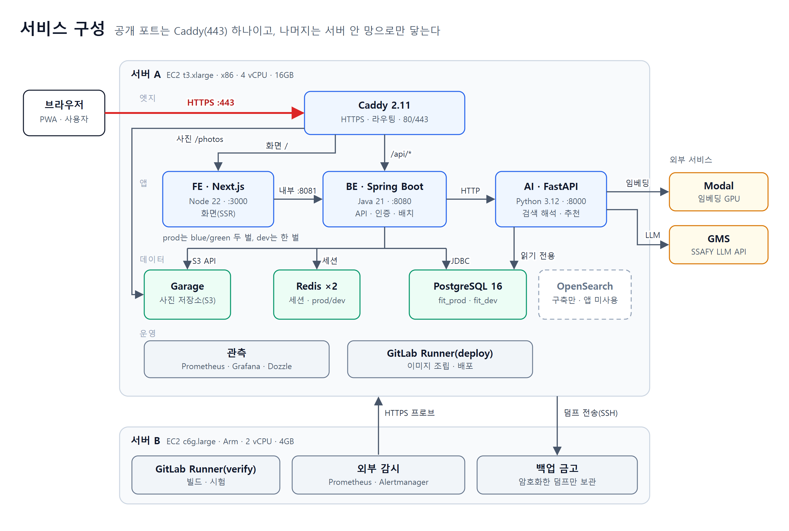
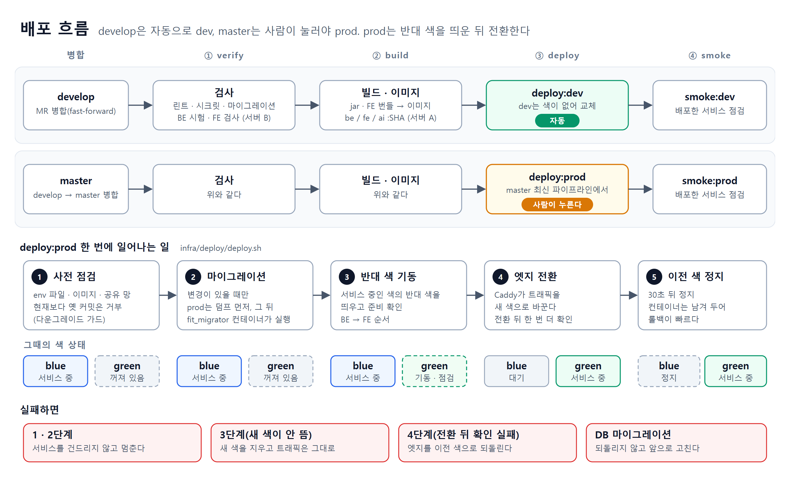
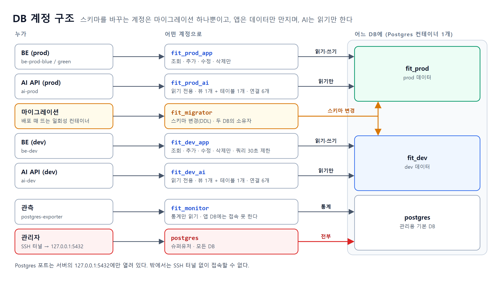
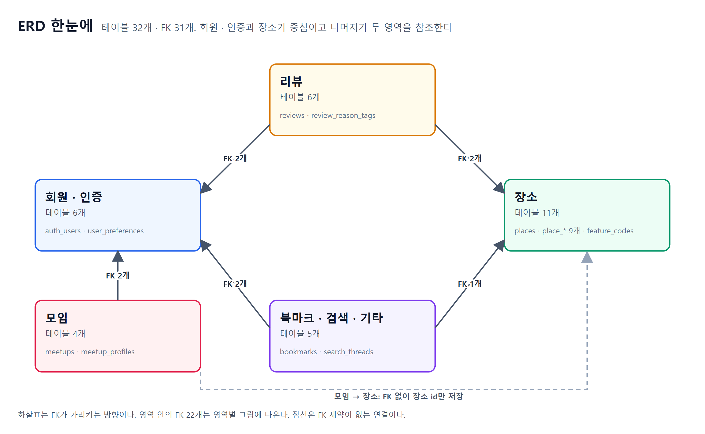
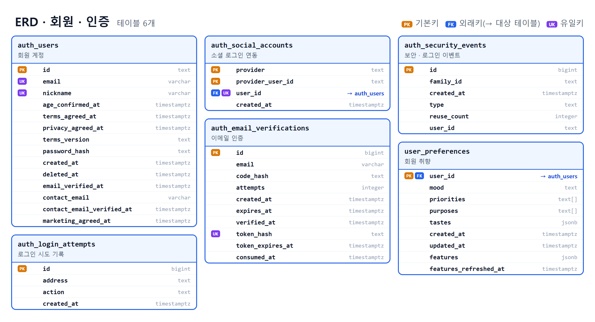
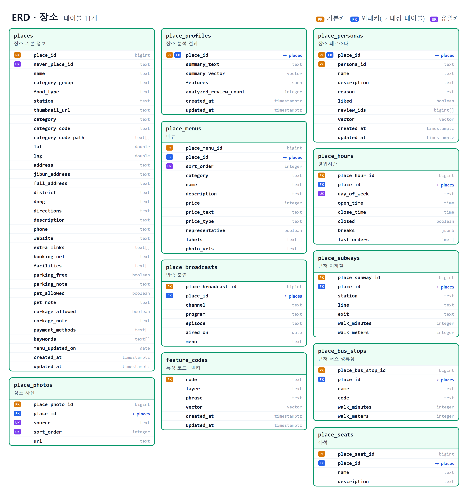
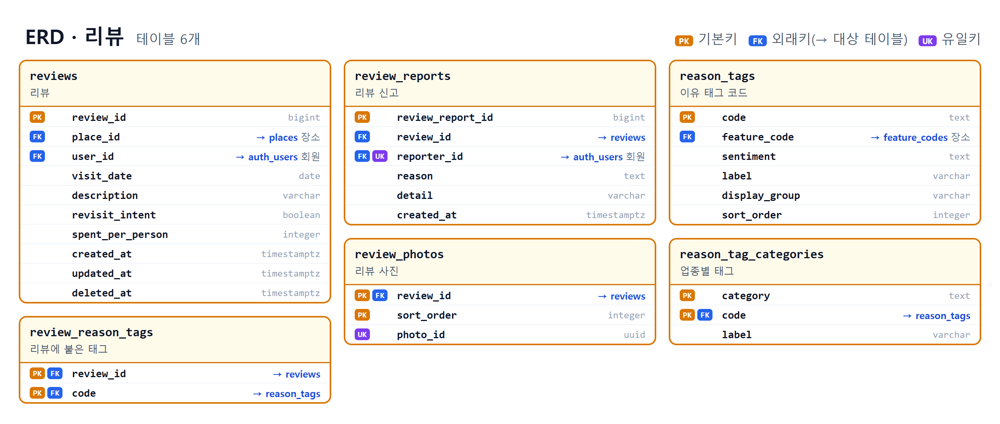
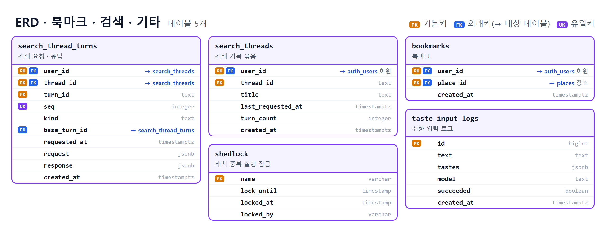
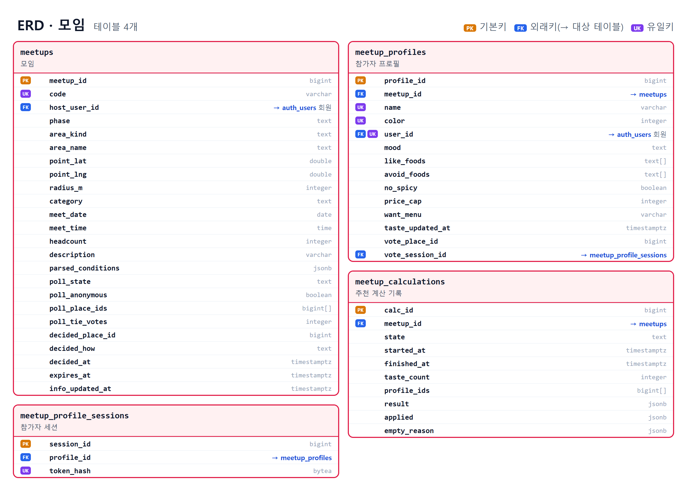

# 핏다이닝(FitDining) 포팅 매뉴얼

GitLab 소스를 clone한 뒤 **빌드하고 배포**하는 방법을 정리했다.

| 항목 | 내용 |
|---|---|
| 저장소 | `https://lab.ssafy.com/s15-final/S15P31A302` |
| 기준 | `develop` `0bb4c5f9` (2026-11-12) |
| 서비스 | prod `https://fitdining.co.kr` · dev `https://dev.fitdining.co.kr`(접근 키 필요) |
| 구성 | BE Spring Boot 4.1.1(Java 21) · FE Next.js 16.4.2(Node 22) · AI FastAPI(Python 3.12) · DB PostgreSQL 16 |
| 종료 | 2026-11-18 ([RB-10](../docs/infra/runbooks/RB-10.md)) |

**목차** 0 구성 · 1 제품·버전·설정값 · 2 빌드 환경변수 · 3 빌드·배포 · 4 DB 접속 정보 · 부록 A ERD · 부록 B 외부 서비스 · 검증 기록

---

## 0. 구성



---

## 1. 제품 · 버전 · 설정값

### 1.1 제품과 버전

| 구분 | 제품 | 버전 |
|---|---|---|
| JVM | Eclipse Temurin | 21.0.12 |
| WAS | Spring Boot 내장 Tomcat | Spring Boot 4.1.1 |
| FE 런타임 | Node.js | 22.23.4 |
| FE 프레임워크 | Next.js / React | 16.4.2 / 19.3.0 |
| AI 런타임 | Python | 3.12.15 |
| 웹서버 | Caddy | 2.11.7 |
| DB | PostgreSQL + pgvector | 16 / 0.8.7 |
| 세션 | Redis (prod, dev 2개) | 7.4.9 |
| 사진 저장소 | Garage (S3 호환) | 2.4.1 |
| 검색(구축만) | OpenSearch + nori | 3.9.0 — 앱은 사용하지 않는다 |
| 빌드 도구 | Gradle / pnpm / uv | 9.8.1 / 11.20.0 / 0.12.5 |
| IDE | IntelliJ IDEA | 2026.1.4 |
| 감시 | Prometheus / Grafana / Alertmanager | 3.15.0 / 12.4.12 / 0.34.1 |
| 컨테이너 | Docker Engine / Compose | 29.9.2 / 5.6.1 (서버 A, B 같음) |
| 서버 A | EC2 t3.xlarge | Ubuntu 24.04.4 LTS · x86_64 · 4 vCPU · 16GB |
| 서버 B | EC2 c6g.large | Ubuntu 24.04.5 LTS · aarch64(Arm) · 2 vCPU · 4GB |

출처: [Dockerfile.be](../infra/app/Dockerfile.be) · [Dockerfile.fe](../infra/app/Dockerfile.fe) · [Dockerfile.ai](../infra/app/Dockerfile.ai) · [compose.data.yml](../infra/data/compose.data.yml) · [compose.edge.yml](../infra/edge/compose.edge.yml) · [compose.obs.yml](../infra/obs/compose.obs.yml) · [build.gradle](../be/build.gradle) · [package.json](../fe/package.json) · [설계 1.2절](../docs/infra/design.md). 서버 OS와 Docker 버전은 2026-11-12에 서버에서 직접 확인했다.

### 1.2 주요 설정값

| 대상 | 메모리 한도 | 주요 설정 |
|---|---|---|
| BE | prod 1536m(색마다) · dev 1024m | 포트 8080(API) · 8081(관리, 비공개) / 커넥션 풀 prod 10 · dev 5 |
| BE JVM | — | `-XX:InitialRAMPercentage=25 -XX:MaxRAMPercentage=60 -XX:MaxMetaspaceSize=192m -XX:+UseSerialGC` |
| FE | prod 512m · dev 400m | Node 힙 384MB / 루트 파일시스템 읽기 전용 |
| AI | prod 512m · dev 400m | 포트 8000 |
| PostgreSQL | 1g | `shared_buffers` 256MB / `max_connections` 60 |
| Redis | 128m | `maxmemory` 96mb / `noeviction` / AOF `everysec` / `requirepass` |
| Garage | 192m | 리전 `garage`(path-style) |
| OpenSearch(앱 미사용) | 2g | 힙 768m / 단일 노드 |
| Caddy | 150m | HTTP/1.1 + 2 / zstd, gzip / 본문 상한 API 2MB, 사진 10MB |
| 호스트 | — | 시간대 `Asia/Seoul` / 스왑 4GB / 방화벽 22(제한)·80·443만 |

출처: [compose.app.yml](../infra/app/compose.app.yml) · [compose.data.yml](../infra/data/compose.data.yml) · [compose.edge.yml](../infra/edge/compose.edge.yml) · [Caddyfile](../infra/edge/conf/Caddyfile) · [application.yml](../be/src/main/resources/application.yml) · [설계 3절](../docs/infra/design.md)

---

## 2. 빌드 시 사용되는 환경변수

값은 적지 않는다. 서버의 값은 `/etc/fit/*.env`에 있고, 저장소에는 키만 든 `*.env.example`이 있다(목록은 4.5절). 전체 키와 설명은 [env.md](../docs/infra/contracts/env.md)다.

### 2.1 빌드 때 필요한 것

| 대상 | 변수 | 용도 |
|---|---|---|
| BE jar | 없음 | `bootJar`에 필수 변수가 없다. 시험(`test`)만 Docker가 필요하다 |
| FE 번들 | `DEPLOYMENT_VERSION` | 커밋 SHA. 빌드 ID와 배포 ID가 된다(로컬은 생략 가능) |
| CI 빌드 | `GRADLE_OPTS`, `NODE_OPTIONS`, `npm_config_store_dir` | 메모리와 캐시 위치 |
| 이미지 | `SHA`, `BUILT_AT`, `BASE_IMAGE` | Docker `ARG`. 이미지에 커밋·시각을 남긴다 |

> FE는 `NEXT_PUBLIC_*`을 쓰지 않는다. 같은 번들을 dev와 prod에 배포하고, 환경별 값은 **실행할 때** 읽는다.

### 2.2 실행 때 필요한 것(키 이름만)

| 서버 파일(`/etc/fit/`) | 읽는 곳 | 주요 키 |
|---|---|---|
| `prod.env`, `dev.env` | BE | `SPRING_DATASOURCE_*` `SPRING_DATA_REDIS_*` `S3_*` `JWT_SECRET` `AUTH_*` `SPRING_MAIL_*` `MODAL_*` `GMS_*` |
| `migrate-<환경>.env` | 마이그레이션 | `SPRING_DATASOURCE_*`(DDL 계정) |
| `fe-<환경>.env` | FE | `BE_INTERNAL_URL` `NODE_OPTIONS` `NAVER_MAP_CLIENT_ID` `POSTHOG_*` |
| `ai-<환경>.env` | AI | `DATABASE_URL` `GMS_*` `EMBED_*` |
| `data.env` | 데이터 스택 | `POSTGRES_PASSWORD` `FIT_*_PASSWORD` `REDIS_*_PASSWORD` `S3_*_KEY` `GARAGE_*` |
| `edge.env` | Caddy | `PROD_HOST` `DEV_HOST` `ACME_*` `HSTS_MODE` `DEV_GATE_KEY` `B_IP` |
| `obs.env` `ops.env` `backup.env` | 감시, 백업 | 알림 웹훅, 백업 보관 설정 |

---

## 3. 빌드와 배포

### 3.1 로컬에서 clone부터 실행까지

아래 명령은 새로 clone한 사본에서 그대로 실행해 확인했다(검증 기록 참고).

필요한 것: Git · Docker(Compose v2 이상) · bash(Windows는 Git Bash) · JDK 21 · Node 22(corepack 포함. **Node 25 이상에는 corepack이 없다**) · (선택) uv

```bash
git clone https://lab.ssafy.com/s15-final/S15P31A302.git && cd S15P31A302

# 1. 로컬 DB·Redis·S3
cp infra/local/local.env.example infra/local/.env
bash infra/local/fit-local.sh up

# 2. BE: 환경 파일(아래 표의 값을 채운다) → 스키마 생성(마이그레이션 프로필로 1회) → 실행(8080)
cp be/.env.example be/.env
cd be
APP_ENV=dev SPRING_PROFILES_ACTIVE=migrate SPRING_DATASOURCE_URL=jdbc:postgresql://127.0.0.1:15432/fit_dev \
SPRING_DATASOURCE_USERNAME=fit_migrator SPRING_DATASOURCE_PASSWORD=local-migrator-password sh ./gradlew bootRun
sh ./gradlew bootRun

# 3. FE(3000): 다른 터미널, 저장소 루트에서
cd fe && corepack enable && pnpm install && cp .env.example .env.local && pnpm dev
```

**`be/.env`에 채울 값**(로컬 개발용)

| 키 | 값 |
|---|---|
| `SPRING_DATASOURCE_PASSWORD` | `local-app-password` |
| `SPRING_DATA_REDIS_PASSWORD` (줄을 추가한다) | `local-redis-password` |
| `JWT_SECRET` | 아무 Base64 32바이트 이상. 예: `openssl rand -base64 32` |
| `S3_BUCKET` `S3_ACCESS_KEY` `S3_SECRET_KEY` | `infra/local/.env`의 같은 이름 값(비워 두면 사진 업로드만 503) |

> **마이그레이션 성공 확인:** 로그 끝에 `Successfully applied 29 migrations ... now at version v30`이 나온다. 실패해도 Gradle은 `BUILD SUCCESSFUL`로 끝나므로 `Application run failed`가 없는지 로그를 본다(`APP_ENV=dev`가 없으면 BE가 기동을 거부한다).

- AI(선택): `cd ai && uv sync && cp .env.example .env && uv run --env-file .env uvicorn server.main:app` (Modal 임베딩 설정이 없으면 `/healthz`가 503이다. 정상이다)
- BE 시험: `cd be && sh ./gradlew test` (Docker 필요)
- 로컬 스택 점검·정지·초기화: `fit-local.sh verify` · `down` · `reset` ([README](../infra/local/README.md))

### 3.2 빌드

```bash
# BE: jar → be/build/libs/*.jar
cd be && sh ./gradlew --no-daemon bootJar -x test && cd ..

# FE(Node 22): 번들 → fe-bundle/
cd fe && corepack enable && pnpm install --frozen-lockfile
DEPLOYMENT_VERSION=<SHA> pnpm build
mkdir -p ../fe-bundle && cp -r .next/standalone ../fe-bundle/standalone \
  && cp -r .next/static ../fe-bundle/static && cp -r public ../fe-bundle/public && cd ..

# 이미지: be:<SHA> fe:<SHA> (ai:<SHA>는 /etc/fit/ai-<환경>.env가 있는 서버에서만)
bash infra/ci/build-images.sh <SHA>
```

출처: [.gitlab-ci.yml](../.gitlab-ci.yml) · [fe/README.md](../fe/README.md)

### 3.3 서버 배포

사람이 서버에서 빌드하지 않는다. **GitLab CI**가 빌드하고, 서버 A의 러너가 배포한다.



| 하고 싶은 일 | 방법(서버 A) |
|---|---|
| 배포 | CI의 `deploy:dev`(develop 병합 때 자동), `deploy:prod`(master, 수동)가 `deploy.sh`를 실행한다. CI 없이 직접 해야 하면 [RB-02b](../docs/infra/runbooks/RB-02b.md)(전체 이력 clone과 `SKIP_VERIFY=<사유>`가 필요하다) |
| 되돌리기 | `sudo bash ~/fit-repo/infra/deploy/rollback.sh <prod\|dev> [be\|fe\|ai\|all]` |
| 활성 색 보기 | `sudo bash ~/fit-repo/infra/edge/edgectl.sh status` |

**서버를 처음 세울 때**([RB-12](../docs/infra/runbooks/RB-12.md), [host README](../infra/host/README.md))

1. 호스트: `sudo ROLE=app FIT_PEER_IP=<B의 IP> bash ~/host/bootstrap.sh` → `verify-host.sh`(전부 PASS)
2. 저장소 사본을 서버에 올린다([런북 README](../docs/infra/runbooks/README.md)의 "서버에 있는 스크립트 사본"). 내 PC의 저장소 루트에서(Windows는 Git Bash):
   `git archive HEAD infra docs/infra/contracts | ssh -i <키 파일> ubuntu@<서버> 'mkdir -p ~/fit-repo && tar -x --overwrite -C ~/fit-repo'`
3. 엣지 상태 파일: `infra/edge/state-sample/` → `/srv/fit/state/`
4. `/etc/fit/*.env`를 만든다(2.2절). 값은 [envset.py](../infra/host/envset.py)로 넣는다
5. 데이터: `sudo docker compose -p fit-data -f ~/fit-repo/infra/data/compose.data.yml --env-file /etc/fit/data.env up -d --wait` → `sudo bash ~/fit-repo/infra/data/init-data.sh`
6. 엣지·관측: `sudo bash ~/fit-repo/infra/deploy/fit-up.sh`
7. 러너 등록: `sudo bash ~/host/runner.sh install` → `register`
8. 앱 배포: GitLab에서 `build:images` → `deploy:dev`, `master`의 `deploy:prod`

### 3.4 배포 시 특이사항

| 항목 | 핵심 |
|---|---|
| 마이그레이션 | 웹 앱은 DML 전용이라 Flyway가 꺼져 있다. 배포 때 `fit_migrator` 일회성 컨테이너가 실행한다. **적용된 파일은 수정 금지**(CI `lint:migrations`), 되돌리지 않고 앞으로 고친다 |
| 시크릿 | 서버 `/etc/fit/*.env`에만 둔다. **env를 바꿔도 떠 있는 컨테이너는 다시 읽지 않는다 → 같은 SHA를 다시 배포** |
| 환경 분리 | 호스트 이름으로 나눈다(같은 443). dev는 `/?k=<키>`로 쿠키를 받아야 열린다 |
| 포트 | 공개는 Caddy 80/443뿐이다. DB는 SSH 터널로만 닿는다(`127.0.0.1:5432`) |
| FE → BE | `BE_INTERNAL_URL`은 prod `http://caddy:8081`, dev `http://caddy:8082`. 활성 색은 엣지 상태 파일 한 곳에서 고른다 |
| Redis | `--notify-keyspace-events Egx`가 필요하다(세션). 내려가면 BE readiness가 DOWN이라 새 색으로 전환되지 않는다 |
| CI 러너 | 무거운 빌드는 Arm 서버 B, A의 러너는 이미지 `COPY`와 배포만 한다. 이미지는 amd64와 arm64 둘 다 있어야 한다 |
| AI API | `ai-<환경>.env`가 있는 환경에만 배포한다. 실패해도 BE·FE 배포는 계속한다(키워드 검색으로 대체) |
| OpenSearch | 데이터 스택 compose에 있어 컨테이너는 뜨지만 **BE·AI·FE 코드는 연결하지 않는다.** 키워드 검색은 BE 메모리 매처, AI 검색은 Postgres(pgvector)가 한다. `OPENSEARCH_*` env 키가 있어도 쓰이지 않는다 |
| 인증서 | Let's Encrypt(안 되면 ZeroSSL), 80 포트 상시 개방. `caddy_data` 볼륨은 지우지 않는다 |
| 보안 헤더 | CSP는 허용 목록이다. 새 외부 출처를 쓰면 [Caddyfile](../infra/edge/conf/Caddyfile)의 목록도 고친다 |
| 외부 서비스 | 소셜 로그인 콜백 URL 등록, 카카오 이메일 동의, NCP 지도 Web 서비스 URL 등록이 먼저다(부록 B) |
| 종료 | 2026-11-18. 최종 백업, 합성 덤프, 실데이터 삭제는 [RB-10](../docs/infra/runbooks/RB-10.md) |

---

## 4. DB 접속 정보와 계정, 프로퍼티 정의 파일

이 문서에는 비밀번호와 시크릿 **값을 적지 않는다.** 키 이름과 정의된 위치(서버의 `/etc/fit/data.env`, `prod.env`, `dev.env`)만 적는다.

### 4.1 접속 정보

| 대상 | 서버(컨테이너 망 안) | 로컬 |
|---|---|---|
| PostgreSQL | `postgres:5432` · DB `fit_prod`, `fit_dev`(한 컨테이너) · 호스트는 `127.0.0.1:5432`만(터널용) | `127.0.0.1:15432` · DB `fit_dev` |
| Redis | prod `redis-prod:6379` · dev `redis-dev:6379` | `127.0.0.1:16379` |
| Garage(S3) | `http://garage:3900` · 리전 `garage` · 버킷 `fit-prod-photos`, `fit-dev-photos` | `http://127.0.0.1:13900` · 버킷 `fit-dev-photos` |

JDBC URL: `jdbc:postgresql://<호스트>:<포트>/<DB>` — 서버 BE는 `jdbc:postgresql://postgres:5432/fit_prod`(dev는 `fit_dev`)

### 4.2 Postgres 계정



| 계정 | 권한 | DB | `data.env`의 비밀번호 키 |
|---|---|---|---|
| `postgres` | 슈퍼유저 | 전부 | `POSTGRES_PASSWORD` |
| `fit_migrator` | DDL, DB 소유자 | `fit_prod` `fit_dev` | `FIT_MIGRATOR_PASSWORD` |
| `fit_prod_app` | DML만 | `fit_prod` | `FIT_PROD_APP_PASSWORD` |
| `fit_dev_app` | DML만, 쿼리 30초 | `fit_dev` | `FIT_DEV_APP_PASSWORD` |
| `fit_prod_ai` | 읽기 전용(뷰 1 + 테이블 1), 연결 6 | `fit_prod` | `FIT_PROD_AI_PASSWORD` |
| `fit_dev_ai` | 위와 같음 | `fit_dev` | `FIT_DEV_AI_PASSWORD` |
| `fit_monitor` | 통계만 읽기 | `postgres` | `FIT_MONITOR_PASSWORD` |

계정은 [ensure-databases.sh](../infra/data/ensure-databases.sh), AI 읽기 권한은 [grant-ai-read.sh](../infra/data/grant-ai-read.sh)가 만든다.
로컬 개발용 값(가짜 값, [local.env.example](../infra/local/local.env.example)): `postgres` `local-postgres-password` · `fit_migrator` `local-migrator-password` · `fit_dev_app` `local-app-password`

### 4.3 Redis

사용자 이름 없이 비밀번호(`requirepass`) 하나만 쓴다.

| 대상 | `data.env`의 비밀번호 키 |
|---|---|
| `redis-prod` | `REDIS_PROD_PASSWORD` |
| `redis-dev` | `REDIS_DEV_PASSWORD` |
| 로컬 | `REDIS_PASSWORD` = `local-redis-password` |

### 4.4 DB 조회 방법

서버 DB 포트는 `127.0.0.1`에만 열려 있어서 **서버에 SSH로 들어갈 수 있는 사람(`.pem` 보유자)만** 조회할 수 있다. 비밀번호는 서버의 `/etc/fit/data.env`에 있다.

| 방법 | 비밀번호 |
|---|---|
| ① 서버에서 직접(SSH 접속 후 컨테이너 안에서) | 필요 없다 |
| ② 내 PC에서 SSH 터널로 | 필요(`FIT_PROD_APP_PASSWORD`) |
| ③ 로컬 개발 DB | 필요 없다 |

```bash
# ① 서버 A에 접속한 뒤 컨테이너 안에서 조회
ssh -i <키 파일> ubuntu@k15a302.p.ssafy.io
sudo docker exec -it fit-data-postgres-1 psql -U postgres -d fit_prod     # dev는 -d fit_dev

# ② 내 PC에서: 터널을 켜 둔 채 다른 터미널에서 접속
ssh -i <키 파일> -N -L 15433:127.0.0.1:5432 ubuntu@k15a302.p.ssafy.io
psql -h 127.0.0.1 -p 15433 -U fit_prod_app -d fit_prod

# ③ 로컬 개발 DB
docker exec -it fit-local-postgres-1 psql -U postgres -d fit_dev
```

- ②는 IntelliJ의 Database 도구로도 같다. 터널을 켜고 호스트 `127.0.0.1`, 포트 `15433`, DB `fit_prod`, 계정 `fit_prod_app`으로 접속한다.
- 팀원은 `fit-dev` 계정으로 터널만 만들 수 있고 dev DB(`fit_dev_app`)만 본다([data README](../infra/data/README.md)).
- **조회만 할 때**는 접속 전에 `PGOPTIONS='-c default_transaction_read_only=on'`을 설정하면 쓰기가 막힌다(`CREATE TABLE`이 거부되고 `select`는 된다).
- 회원·리뷰 테이블에는 개인정보가 있으니 결과를 밖에 붙여 넣지 않는다.

```sql
\dt                                  -- 테이블 목록(33개: 앱 32개 + Flyway 기록 1개)
\d places                            -- 테이블 구조
select count(*) from places;         -- 행 수
select version, description from flyway_schema_history order by installed_rank desc limit 3;   -- 적용된 마이그레이션
```

### 4.5 계정과 프로퍼티가 정의된 파일

| 구분 | 파일 | 정의된 것 |
|---|---|---|
| BE | [application.yml](../be/src/main/resources/application.yml) | 포트, DB·Redis 접속, 풀, 세션, JPA, 메일, 관리 포트 |
| BE | [application-migrate.yml](../be/src/main/resources/application-migrate.yml) | 마이그레이션 프로필 |
| BE | [db/migration/](../be/src/main/resources/db/migration) | 스키마 `V1`~`V30` |
| BE | [be/.env.example](../be/.env.example) · [build.gradle](../be/build.gradle) · [gradle-wrapper.properties](../be/gradle/wrapper/gradle-wrapper.properties) | 로컬 환경변수, 의존성, Gradle 버전 |
| FE | [fe/.env.example](../fe/.env.example) · [package.json](../fe/package.json) · [next.config.ts](../fe/next.config.ts) | 로컬 환경변수, 의존성, Next 설정 |
| AI | [ai/.env.example](../ai/.env.example) · [pyproject.toml](../ai/pyproject.toml) · [uv.lock](../ai/uv.lock) | 환경변수, 의존성 |
| 서버 env 예제 | [app](../infra/app/app.env.example) · [migrate](../infra/app/migrate.env.example) · [fe](../infra/app/fe.env.example) · [ai](../infra/app/ai.env.example) · [data](../infra/data/data.env.example) · [edge](../infra/edge/edge.env.example) · [obs](../infra/obs/obs.env.example) · [ops](../infra/ops/ops.env.example) · [backup](../infra/backup/backup.env.example) | `/etc/fit/*.env`의 키 |
| 컨테이너 | [compose.app.yml](../infra/app/compose.app.yml) · [compose.data.yml](../infra/data/compose.data.yml) · [compose.edge.yml](../infra/edge/compose.edge.yml) · [Dockerfile.be](../infra/app/Dockerfile.be) · [Dockerfile.fe](../infra/app/Dockerfile.fe) · [Dockerfile.ai](../infra/app/Dockerfile.ai) | 메모리, 포트, 이미지 |
| DB 초기화 | [ensure-databases.sh](../infra/data/ensure-databases.sh) · [grant-ai-read.sh](../infra/data/grant-ai-read.sh) · [init-garage.sh](../infra/data/init-garage.sh) · [garage.toml](../infra/data/garage/garage.toml) | 계정, 권한, 버킷 |
| 엣지 | [Caddyfile](../infra/edge/conf/Caddyfile) | 라우팅, 인증서, 보안 헤더 |
| 로컬 | [local.env.example](../infra/local/local.env.example) · [compose.yml](../infra/local/compose.yml) | 로컬 개발 스택 |
| CI | [.gitlab-ci.yml](../.gitlab-ci.yml) · [tool-images.sh](../infra/ci/tool-images.sh) | 단계, 러너, 도구 버전 |
| 키 목록 | [env.md](../docs/infra/contracts/env.md) | 환경변수 전체 |
| 서버에만 있음 | `/etc/fit/*.env` · `/srv/fit/state/` | 값, 활성 색·이미지 태그·배포 이력 |

---

## 부록 A. ERD

테이블 **32개**, FK **31개**(마이그레이션 `V30` 적용 후). `V28`, `V29`는 없는 번호다.



### A.1 회원 · 인증 (6)



### A.2 장소 (11)



### A.3 리뷰 (6)



### A.4 북마크 · 검색 · 기타 (5)



### A.5 모임 (4)



### A.6 FK 없이 연결된 컬럼

| 컬럼 | 가리키는 곳 |
|---|---|
| `meetups.poll_place_ids` `meetups.decided_place_id` `meetup_profiles.vote_place_id` | `places.place_id` |
| `place_personas.review_ids` | `reviews.review_id` |
| `meetup_calculations.profile_ids` | `meetup_profiles.profile_id` |
| `auth_security_events.user_id` | `auth_users.id` |

- **뷰:** `ai_place_search` 1개(AI 읽기용, 장소·프로필·지하철·영업시간·메뉴를 묶는다). 머티리얼라이즈드 뷰는 없다.
- **그림 소스:** [images/src/](images/src)의 HTML을 브라우저로 찍은 것이다.
- **검증:** 로컬 DB에 `V30`까지 실제로 적용해서 테이블 32개, FK 31개, 컬럼 수를 대조했다(서버 DB와는 대조하지 않았다).

---

## 부록 B. 외부 서비스와 키(이름만)

| 서비스 | 용도 | 키 |
|---|---|---|
| 네이버 지도 | 지도 | `NAVER_MAP_CLIENT_ID`(공개 값). NCP 콘솔에 prod·dev 호스트 등록 |
| 구글 · 카카오 · 네이버 로그인 | 소셜 로그인 | `AUTH_{GOOGLE,KAKAO,NAVER}_CLIENT_ID` `_CLIENT_SECRET`. 콜백 `https://<호스트>/api/auth/oauth/<제공자>/callback` 등록 |
| GMS(SSAFY LLM) | 요청 해석·정렬 | `GMS_BASE_URL` `GMS_API_KEY` `GMS_ENABLED` |
| Modal | 임베딩 | `EMBED_BASE_URL` `EMBED_KEY` `EMBED_SECRET` |
| Gmail SMTP | 가입 인증 메일 | `SPRING_MAIL_*` `AUTH_MAIL_FROM` |
| PostHog | 행동 분석(선택) | `POSTHOG_KEY` `POSTHOG_HOST` |
| Mattermost | 알림 | `MATTERMOST_WEBHOOK_URL` `MATTERMOST_WEBHOOK_URL_DEV` |
| 가비아 | DNS | `fitdining.co.kr`, `dev.fitdining.co.kr`의 A 레코드(TTL 600초) → 서버 A |

---

## 검증 기록

2026-11-12, 새 clone, Windows 11 · JDK 21.0.11 · Docker 29.9.2 · Node 22는 `node:22.23.4` 컨테이너.

| 절 | 확인한 것 | 결과 |
|---|---|---|
| 3.1 | `fit-local.sh up` | 점검 13개 통과, `로컬 스택 정상` |
| 3.1 | 마이그레이션 | `now at version v30`, 테이블 32개 · FK 31개 · 컬럼 수가 ERD와 일치 |
| 3.1 | BE 실행 | `/healthz` 200, 관리 포트 readiness 200, 공개 포트 `/actuator` 404 |
| 3.1 | FE 실행(`pnpm dev`) | `/` 200, `/config.json`, FE를 거친 BE 호출 정상 |
| 3.1 | AI 실행 | 서버 기동, Modal 설정이 없어 `/healthz` 503(정상) |
| 3.1 | BE 시험 | 1,693개 전부 통과(실패 0, 9분 9초) |
| 3.2 | BE jar | 87MB `api-0.0.1-SNAPSHOT.jar` |
| 3.2 | FE 번들 | `pnpm build` 성공, `fe-bundle/` 구성 |
| 3.2 | 이미지 조립 | `build-images.sh`가 be, fe 이미지 조립(ai는 `ai-<환경>.env`가 없어 건너뜀) |

- **문서 내용:** 버전 18개와 설정값 24개를 출처 파일과 대조했다(불일치 0). 링크와 이미지 경로가 모두 존재한다.
- **서버에서만 실행하는 3.3절 명령:** 로컬에서 실행하지 않고, 스크립트의 인자와 하위 명령이 문서와 맞는지만 소스와 대조했다(`deploy.sh`, `rollback.sh`, `edgectl.sh`, `bootstrap.sh`, `runner.sh`).
